# Diagramas de atividades

**Responsável:** Edson · Os nomes seguem o [glossário](../classes/glossario.md) e as restrições estão em [restricoes.md](../servicos/restricoes.md).

Cada diagrama tem **raias** (colunas) para os atores envolvidos: Utilizador, Gestor, Aplicação web e serviços externos. As imagens para o relatório estão em [`img/`](img).

**Notação:**
- ⚫ círculo preto = início; ◉ círculo duplo = fim
- retângulo arredondado = ação
- losango = decisão, com as condições `[sim]` / `[não]` nas setas
- ação com ⊕ = subatividade, decomposta num diagrama próprio

| # | Diagrama | User stories |
|---|---|---|
| 1 | Comprar álbuns (alto nível) | US8, US9, US26, US27, US28 |
| 1.1 | ⊕ Pagar o carrinho (subatividade) | US28 |
| 2 | Pedido de nova versão de um álbum | US12, US13, US14, US24, US9, US10 |
| 3 | Criar conta e iniciar sessão | US1, US2, US19 |
| 4 | Gerir o catálogo (gestor) | US20, US22, US25 |

---

## 1. Comprar álbuns (alto nível)

Vai da pesquisa de um álbum até ao fim da compra. O pagamento é uma subatividade (diagrama 1.1), que já trata o sucesso, a falha, a nova tentativa e o cancelamento.

```mermaid
flowchart TB
  subgraph U["Utilizador"]
    direction TB
    I1((" ")) --> A1("Pesquisar álbum pelo título")
    A3("Abrir a página do álbum")
    A5("Escolher uma versão")
    A7("Colocar a versão no carrinho")
    D2{"Continuar a comprar?"}
    A9("Ver o carrinho")
    D3{"Remover algum álbum?"}
    A10("Remover álbum do carrinho")
    A11("⊕ Pagar o carrinho")
    F1(((" ")))
  end
  subgraph W["Aplicação web"]
    direction TB
    A2("Sugerir álbuns com título parecido")
    A4("Mostrar dados, faixas, versões e disponibilidade")
    D1{"Versão disponível na loja?"}
    A6("Mostrar que a versão não está disponível")
    A8("Atualizar o número de itens no ícone do carrinho")
    A12("Mostrar itens do carrinho, mais recentes primeiro")
  end

  A1 --> A2 --> A3 --> A4 --> A5 --> D1
  D1 -->|"[não]"| A6 --> D2
  D1 -->|"[sim]"| A7 --> A8 --> D2
  D2 -->|"[sim]"| A1
  D2 -->|"[não]"| A9 --> A12 --> D3
  D3 -->|"[sim]"| A10 --> A12
  D3 -->|"[não]"| A11 --> F1

  style I1 fill:#000,stroke:#000
  style F1 fill:#000,stroke:#000
  style U fill:#fef9c3,stroke:#a16207
  style W fill:#dbeafe,stroke:#1d4ed8
```

---

## 1.1 ⊕ Pagar o carrinho (subatividade)

Decomposição da ação "Pagar o carrinho". O resultado chega do serviço externo, e só depois a aplicação emite a fatura (US28 c).

```mermaid
flowchart TB
  subgraph U["Utilizador"]
    direction TB
    I1((" ")) --> P1("Carregar em Pagar")
    P2("Escolher o serviço: Stripe ou PayPal")
    P5("Introduzir os dados de pagamento e confirmar")
    D3{"Tentar com outro serviço?"}
    F1(((" ")))
  end
  subgraph W["Aplicação web"]
    direction TB
    P3("Calcular o total e iniciar o pagamento no serviço")
    P7("Aguardar o resultado do serviço")
    D1{"Pagamento com sucesso?"}
    P8("Emitir fatura (número ano + sequencial)")
    P9("Adicionar as versões à coleção do utilizador")
    P10("Descontar as unidades vendidas")
    D2{"Vendida a última unidade?"}
    P11("Registar a data da última venda")
    P12("Esvaziar o carrinho")
    P13("Mostrar resumo: fatura, coleção e stock")
    P14("Mostrar mensagem de pagamento falhado")
    P15("Cancelar o pagamento")
  end
  subgraph S["Serviço de pagamentos"]
    direction TB
    P4("Mostrar página de pagamento")
    P6("Processar o pagamento e enviar o resultado")
  end

  P1 --> P2 --> P3 --> P4 --> P5 --> P6 --> P7 --> D1
  D1 -->|"[sim]"| P8 --> P9 --> P10 --> D2
  D2 -->|"[sim]"| P11 --> P12
  D2 -->|"[não]"| P12
  P12 --> P13 --> F1
  D1 -->|"[não]"| P14 --> D3
  D3 -->|"[sim]"| P2
  D3 -->|"[não]"| P15 --> F1

  style I1 fill:#000,stroke:#000
  style F1 fill:#000,stroke:#000
  style U fill:#fef9c3,stroke:#a16207
  style W fill:#dbeafe,stroke:#1d4ed8
  style S fill:#dcfce7,stroke:#15803d
```

**Restrições aplicadas:** RI-27 e RI-28 (data e número da fatura), RI-15 (unidades nunca negativas), RI-17 (data da última venda).

---

## 2. Pedido de nova versão de um álbum

Junta os passos de quatro user stories: o utilizador pede (US12), o gestor responde (US24), o utilizador é notificado (US14) e pode adicionar a versão à coleção (US10).

```mermaid
flowchart TB
  subgraph U["Utilizador"]
    direction TB
    I1((" ")) --> R1("Escolher o álbum")
    R2("Preencher EAN-13, suporte físico e designação")
    R3("Submeter o pedido")
    R8("Abrir a notificação no dashboard")
    D3{"Pedido aceite?"}
    R10("Adicionar a nova versão à coleção")
    F1(((" ")))
  end
  subgraph W["Aplicação web"]
    direction TB
    D1{"Dados válidos?"}
    R4("Mostrar erro com o motivo")
    R5("Guardar o pedido com estado 'em análise'")
    R6("Criar a versão no álbum e mudar o estado para 'aceite'")
    R7("Mudar o estado para 'recusado'")
    R9("Criar a notificação para o utilizador")
  end
  subgraph G["Gestor"]
    direction TB
    R11("Abrir o pedido")
    D2{"Versão nova e interessante para a loja?"}
  end

  R1 --> R2 --> R3 --> D1
  D1 -->|"[não]"| R4 --> R2
  D1 -->|"[sim]"| R5 --> R11 --> D2
  D2 -->|"[sim]"| R6 --> R9
  D2 -->|"[não]"| R7 --> R9
  R9 --> R8 --> D3
  D3 -->|"[sim]"| R10 --> F1
  D3 -->|"[não]"| F1

  style I1 fill:#000,stroke:#000
  style F1 fill:#000,stroke:#000
  style U fill:#fef9c3,stroke:#a16207
  style W fill:#dbeafe,stroke:#1d4ed8
  style G fill:#fee2e2,stroke:#b91c1c
```

**Restrições aplicadas:** RI-12 e RI-13 (suporte e EAN-13 válidos), RI-43 e RI-44 (identificador e estados do pedido), RI-45 (só se aceita se o EAN-13 ainda não existir).

---

## 3. Criar conta e iniciar sessão

```mermaid
flowchart TB
  subgraph U["Utilizador"]
    direction TB
    I1((" ")) --> C1("Abrir a página de criação de conta")
    C3("Preencher username, e-mail, palavra-passe, NIF, nome, género, morada e data de nascimento")
    C4("Submeter")
    C10("Preencher username e palavra-passe")
    F1(((" ")))
  end
  subgraph W["Aplicação web"]
    direction TB
    C2("Mostrar os requisitos do username e da palavra-passe")
    D1{"Dados válidos?"}
    C5("Mostrar erros a explicar o motivo")
    C6("Cifrar a palavra-passe")
    C7("Pedir as coordenadas da morada")
    D2{"Morada encontrada?"}
    C8("Guardar a conta com as coordenadas")
    C9("Guardar a conta sem coordenadas")
    C12("Mostrar mensagem de conta criada")
    D3{"Credenciais certas?"}
    C13("Mostrar erro genérico, sem revelar se o username existe")
    C14("Mostrar o dashboard")
  end
  subgraph N["Serviço de geocodificação"]
    direction TB
    C11("Converter a morada em coordenadas")
  end

  C1 --> C2 --> C3 --> C4 --> D1
  D1 -->|"[não]"| C5 --> C3
  D1 -->|"[sim]"| C6 --> C7 --> C11 --> D2
  D2 -->|"[sim]"| C8 --> C12
  D2 -->|"[não]"| C9 --> C12
  C12 --> C10 --> D3
  D3 -->|"[não]"| C13 --> C10
  D3 -->|"[sim]"| C14 --> F1

  style I1 fill:#000,stroke:#000
  style F1 fill:#000,stroke:#000
  style U fill:#fef9c3,stroke:#a16207
  style W fill:#dbeafe,stroke:#1d4ed8
  style N fill:#dcfce7,stroke:#15803d
```

**Restrições aplicadas:** RI-18 a RI-24 (dados da conta). A palavra-passe é cifrada antes de ser guardada (RNF-12) e só se envia a morada ao serviço de geocodificação, sem o nome do utilizador.

---

## 4. Gerir o catálogo (gestor)

O gestor regista o artista (se ainda não existir), o álbum ou uma nova versão e, mais tarde, atualiza o stock.

```mermaid
flowchart TB
  subgraph G["Gestor"]
    direction TB
    I1((" ")) --> D1{"O artista já existe?"}
    K1("Registar artista: ISNI, nome, ano de início, solista ou grupo")
    D3{"O álbum já existe?"}
    K3("Registar álbum: MBID, título, tipo, ano, capa, artista ou compilação, e a 1.ª versão")
    K4("Escolher o álbum e registar a nova versão")
    K8("Na página do álbum, alterar as unidades de uma versão")
    K10("Indicar o preço de venda")
    F1(((" ")))
  end
  subgraph W["Aplicação web"]
    direction TB
    D2{"Artista válido?"}
    K2("Mostrar erro com o motivo")
    D4{"Dados válidos?"}
    K5("Mostrar erro com o motivo")
    D5{"Unidades maiores que zero?"}
    K6("Preencher a data de início de disponibilidade")
    K7("Guardar e mostrar mensagem de sucesso")
    D6{"Primeira vez à venda?"}
    K9("Pedir o preço e registar a data de disponibilidade")
    K11("Guardar as novas unidades")
  end

  D1 -->|"[não]"| K1 --> D2
  D2 -->|"[não]"| K2 --> K1
  D2 -->|"[sim]"| D3
  D1 -->|"[sim]"| D3
  D3 -->|"[não]"| K3 --> D4
  D3 -->|"[sim]"| K4 --> D4
  D4 -->|"[não]"| K5 --> D3
  D4 -->|"[sim]"| D5
  D5 -->|"[sim]"| K6 --> K7
  D5 -->|"[não]"| K7
  K7 --> K8 --> D6
  D6 -->|"[sim]"| K9 --> K10 --> K11
  D6 -->|"[não]"| K11
  K11 --> F1

  style I1 fill:#000,stroke:#000
  style F1 fill:#000,stroke:#000
  style G fill:#fee2e2,stroke:#b91c1c
  style W fill:#dbeafe,stroke:#1d4ed8
```

**Restrições aplicadas:** RI-07 e RI-08 (artista); RI-01, RI-02, RI-09, RI-12 e RI-13 (álbum e versão); RI-14, RI-15, RI-16 e RI-47 (disponibilidade, unidades e preço); RI-36 e RI-39 (versões únicas e com designações distintas).
