# Diagramas de atividades

**Responsável:** Edson · Os nomes seguem o [glossário](../classes/glossario.md) e as restrições estão em [restricoes.md](../servicos/restricoes.md).

Os diagramas seguem a notação UML de diagramas de atividades. A fonte de cada um é o bloco Mermaid abaixo; as imagens para o relatório estão em [`img/`](img).

**Notação:**
- ⚫ nó inicial; ◉ nó final
- retângulo arredondado = ação
- losango vazio = **decisão** (uma entrada, várias saídas com guardas `[condição]`) ou **merge** (várias entradas, uma saída)
- barra preta = **fork** (as ações seguintes correm em paralelo) ou **join** (espera que todas terminem)
- cada coluna é uma **raia** (swimlane) de um ator: Utilizador, Gestor, Aplicação web ou serviço externo
- ação com ⊕ = subatividade, decomposta num diagrama próprio

| # | Diagrama | User stories |
|---|---|---|
| 1 | Comprar álbuns (alto nível) | US8, US9, US26, US27, US28 |
| 1.1 | ⊕ Pagar o carrinho (subatividade) | US28 |
| 2 | Pedido de nova versão de um álbum | US9, US10, US12, US13, US14, US24 |
| 3 | Criar conta e iniciar sessão | US1, US2, US19 |
| 4 | Gerir o catálogo (gestor) | US20, US22, US25 |

---

## 1. Comprar álbuns (alto nível)

Vai da pesquisa de um álbum até ao pagamento. O pagamento é uma subatividade (diagrama 1.1), que trata a reserva das unidades, o sucesso, a falha, o tempo esgotado e o cancelamento.

```mermaid
flowchart TB
  subgraph U["Utilizador"]
    direction TB
    I1@{ shape: sm-circ }
    M0@{ shape: diam, label: " " }
    A1("Pesquisar álbum pelo título")
    A3("Abrir a página do álbum")
    A5("Escolher uma versão")
    A7("Colocar a versão no carrinho")
    D2@{ shape: diam, label: " " }
    A9("Ver o carrinho")
    D3@{ shape: diam, label: " " }
    A10("Remover álbum do carrinho")
    A11("⊕ Pagar o carrinho")
    F1@{ shape: fr-circ }
  end
  subgraph W["Aplicação web"]
    direction TB
    A2("Sugerir álbuns com título parecido")
    A4("Mostrar dados, faixas, versões e disponibilidade")
    D1@{ shape: diam, label: " " }
    A6("Mostrar que a versão não está disponível")
    A8("Atualizar o número de itens no ícone do carrinho")
    M1@{ shape: diam, label: " " }
    M2@{ shape: diam, label: " " }
    A12("Mostrar itens do carrinho, mais recentes primeiro")
  end

  I1 --> M0 --> A1 --> A2 --> A3 --> A4 --> A5 --> D1
  D1 -->|"[versão indisponível]"| A6 --> M1
  D1 -->|"[versão disponível]"| A7 --> A8 --> M1
  M1 --> D2
  D2 -->|"[continuar a comprar]"| M0
  D2 -->|"[terminar]"| A9 --> M2 --> A12 --> D3
  D3 -->|"[remover um álbum]"| A10 --> M2
  D3 -->|"[pagar]"| A11 --> F1

  style I1 fill:#000,stroke:#000
  style F1 fill:#000,stroke:#000
  style U fill:#fef9c3,stroke:#a16207
  style W fill:#dbeafe,stroke:#1d4ed8
```

---

## 1.1 ⊕ Pagar o carrinho (subatividade)

Antes de pagar, a aplicação **reserva as unidades**, porque outro utilizador pode ter comprado a última unidade entretanto. O resultado chega do serviço externo; se não chegar no tempo limite, a reserva é libertada. Com o pagamento confirmado, a fatura é emitida e, em paralelo, a coleção é atualizada e o stock descontado.

```mermaid
flowchart TB
  subgraph U["Utilizador"]
    direction TB
    I1@{ shape: sm-circ }
    P1("Carregar em Pagar")
    P4("Escolher o serviço: Stripe ou PayPal")
    P7("Introduzir os dados de pagamento e confirmar")
    D4@{ shape: diam, label: " " }
    P18("Cancelar o pagamento")
    F3@{ shape: fr-circ }
  end
  subgraph W["Aplicação web"]
    direction TB
    M0@{ shape: diam, label: " " }
    P2("Verificar e reservar as unidades das versões do carrinho")
    D1@{ shape: diam, label: " " }
    P3("Retirar do carrinho as versões esgotadas e avisar o utilizador")
    F1@{ shape: fr-circ }
    P5("Calcular o total e iniciar o pagamento no serviço")
    P9("Aguardar o resultado do serviço")
    D2@{ shape: diam, label: " " }
    P10("Emitir a fatura com os dados de faturação")
    FK@{ shape: fork }
    P11("Adicionar as versões à coleção, ligadas às linhas da fatura")
    P12("Confirmar a saída das unidades reservadas")
    JN@{ shape: fork }
    D3@{ shape: diam, label: " " }
    P13("Registar a data da última venda")
    M3@{ shape: diam, label: " " }
    P14("Esvaziar o carrinho e mostrar o resumo")
    F2@{ shape: fr-circ }
    M4@{ shape: diam, label: " " }
    P16("Libertar a reserva das unidades")
    P17("Mostrar que o pagamento não foi concluído")
  end
  subgraph S["Serviço de pagamentos"]
    direction TB
    P6("Mostrar a página de pagamento")
    P8("Processar o pagamento e enviar o resultado")
  end

  I1 --> P1 --> M0 --> P2 --> D1
  D1 -->|"[alguma versão esgotou entretanto]"| P3 --> F1
  D1 -->|"[todas as unidades reservadas]"| P4 --> P5 --> P6 --> P7 --> P8 --> P9 --> D2
  D2 -->|"[pagamento com sucesso]"| P10 --> FK
  FK --> P11 --> JN
  FK --> P12 --> JN
  JN --> D3
  D3 -->|"[vendida a última unidade de uma versão]"| P13 --> M3
  D3 -->|"[ainda há unidades]"| M3
  M3 --> P14 --> F2
  D2 -->|"[pagamento recusado]"| M4
  D2 -->|"[sem resposta no tempo limite]"| M4
  M4 --> P16 --> P17 --> D4
  D4 -->|"[tentar com outro serviço]"| M0
  D4 -->|"[desistir]"| P18 --> F3

  style I1 fill:#000,stroke:#000
  style F1 fill:#000,stroke:#000
  style F2 fill:#000,stroke:#000
  style F3 fill:#000,stroke:#000
  style FK fill:#000,stroke:#000
  style JN fill:#000,stroke:#000
  style U fill:#fef9c3,stroke:#a16207
  style W fill:#dbeafe,stroke:#1d4ed8
  style S fill:#dcfce7,stroke:#15803d
```

**Restrições aplicadas:** RI-15 (unidades nunca negativas), RI-17 (data da última venda), RI-27 e RI-28 (data e número da fatura), RI-46 (só versões com unidades), RI-48 (dados de faturação), RI-51 (itens da coleção ligados à linha da fatura).

**Nota sobre o paralelismo:** a fatura é emitida antes do fork porque os itens da coleção ficam ligados às linhas da fatura (RI-51); depois disso, atualizar a coleção e confirmar a saída do stock são independentes e correm em paralelo.

---

## 2. Pedido de nova versão de um álbum

Junta os passos de quatro user stories: o utilizador pede (US12), o gestor responde (US24), o utilizador é notificado (US14) e pode adicionar a versão à coleção (US10).

```mermaid
flowchart TB
  subgraph U["Utilizador"]
    direction TB
    I1@{ shape: sm-circ }
    R1("Escolher o álbum")
    M0@{ shape: diam, label: " " }
    R2("Preencher EAN-13, suporte físico e designação")
    R3("Submeter o pedido")
    R10("Abrir a notificação no dashboard")
    D3@{ shape: diam, label: " " }
    R11("Adicionar a nova versão à coleção")
    M2@{ shape: diam, label: " " }
    F1@{ shape: fr-circ }
  end
  subgraph W["Aplicação web"]
    direction TB
    D1@{ shape: diam, label: " " }
    R4("Mostrar erro com o motivo")
    R5("Guardar o pedido com estado 'em análise'")
    R7("Criar a versão no álbum; estado 'aceite' e data de resposta")
    R8("Estado 'recusado' e data de resposta")
    M1@{ shape: diam, label: " " }
    R9("Criar a notificação, por ler")
  end
  subgraph G["Gestor"]
    direction TB
    R6("Abrir o pedido")
    D2@{ shape: diam, label: " " }
  end

  I1 --> R1 --> M0 --> R2 --> R3 --> D1
  D1 -->|"[dados inválidos]"| R4 --> M0
  D1 -->|"[dados válidos]"| R5 --> R6 --> D2
  D2 -->|"[versão nova e interessante para a loja]"| R7 --> M1
  D2 -->|"[caso contrário]"| R8 --> M1
  M1 --> R9 --> R10 --> D3
  D3 -->|"[pedido aceite]"| R11 --> M2
  D3 -->|"[pedido recusado]"| M2
  M2 --> F1

  style I1 fill:#000,stroke:#000
  style F1 fill:#000,stroke:#000
  style U fill:#fef9c3,stroke:#a16207
  style W fill:#dbeafe,stroke:#1d4ed8
  style G fill:#fee2e2,stroke:#b91c1c
```

**Restrições aplicadas:** RI-12 e RI-13 (suporte e EAN-13 válidos), RI-43 e RI-44 (identificador e estados do pedido), RI-45 (só se aceita se o EAN-13 ainda não existir), RI-49 (data de resposta), RI-50 (notificação criada por ler).

---

## 3. Criar conta e iniciar sessão

Cifrar a palavra-passe e obter as coordenadas da morada são independentes, por isso correm em paralelo (fork/join).

```mermaid
flowchart TB
  subgraph U["Utilizador"]
    direction TB
    I1@{ shape: sm-circ }
    C1("Abrir a página de criação de conta")
    M0@{ shape: diam, label: " " }
    C3("Preencher username, e-mail, palavra-passe, NIF, nome, género, morada e data de nascimento")
    C4("Submeter")
    M2@{ shape: diam, label: " " }
    C12("Preencher username e palavra-passe")
    F1@{ shape: fr-circ }
  end
  subgraph W["Aplicação web"]
    direction TB
    C2("Mostrar os requisitos do username e da palavra-passe")
    D1@{ shape: diam, label: " " }
    C5("Mostrar erros a explicar o motivo")
    FK@{ shape: fork }
    C6("Cifrar a palavra-passe")
    C7("Pedir as coordenadas da morada")
    JN@{ shape: fork }
    D2@{ shape: diam, label: " " }
    C9("Guardar a conta com as coordenadas")
    C10("Guardar a conta sem coordenadas")
    M1@{ shape: diam, label: " " }
    C11("Mostrar mensagem de conta criada")
    D3@{ shape: diam, label: " " }
    C13("Mostrar erro genérico, sem revelar se o username existe")
    C14("Mostrar o dashboard")
  end
  subgraph N["Serviço de geocodificação"]
    direction TB
    C8("Converter a morada em coordenadas")
  end

  I1 --> C1 --> C2 --> M0 --> C3 --> C4 --> D1
  D1 -->|"[dados inválidos]"| C5 --> M0
  D1 -->|"[dados válidos]"| FK
  FK --> C6 --> JN
  FK --> C7 --> C8 --> JN
  JN --> D2
  D2 -->|"[coordenadas obtidas]"| C9 --> M1
  D2 -->|"[morada não encontrada]"| C10 --> M1
  M1 --> C11 --> M2 --> C12 --> D3
  D3 -->|"[credenciais erradas]"| C13 --> M2
  D3 -->|"[credenciais certas]"| C14 --> F1

  style I1 fill:#000,stroke:#000
  style F1 fill:#000,stroke:#000
  style FK fill:#000,stroke:#000
  style JN fill:#000,stroke:#000
  style U fill:#fef9c3,stroke:#a16207
  style W fill:#dbeafe,stroke:#1d4ed8
  style N fill:#dcfce7,stroke:#15803d
```

**Restrições aplicadas:** RI-18 a RI-24 (dados da conta). A palavra-passe é cifrada antes de ser guardada (RNF-12) e só se envia a morada ao serviço de geocodificação, sem o nome do utilizador.

---

## 4. Gerir o catálogo (gestor)

O gestor regista o artista (se ainda não existir), o álbum ou uma nova versão e, mais tarde, atualiza o stock a partir da página do álbum (UC-20 «extend» UC-09).

```mermaid
flowchart TB
  subgraph G["Gestor"]
    direction TB
    I1@{ shape: sm-circ }
    D1@{ shape: diam, label: " " }
    M0@{ shape: diam, label: " " }
    K1("Registar artista: ISNI, nome, ano de início, solista ou grupo")
    M1@{ shape: diam, label: " " }
    D3@{ shape: diam, label: " " }
    K3("Registar álbum: MBID, título, tipo, ano, capa, artista ou compilação, e a 1.ª versão")
    K4("Escolher o álbum e registar a nova versão")
    M2@{ shape: diam, label: " " }
    K8("Na página do álbum, alterar as unidades de uma versão")
    K10("Indicar o preço de venda")
    F1@{ shape: fr-circ }
  end
  subgraph W["Aplicação web"]
    direction TB
    D2@{ shape: diam, label: " " }
    K2("Mostrar erro com o motivo")
    D4@{ shape: diam, label: " " }
    K5("Mostrar erro com o motivo")
    D5@{ shape: diam, label: " " }
    K6("Preencher a data de início de disponibilidade")
    M3@{ shape: diam, label: " " }
    K7("Guardar e mostrar mensagem de sucesso")
    D6@{ shape: diam, label: " " }
    K9("Pedir o preço e registar a data de disponibilidade")
    M4@{ shape: diam, label: " " }
    K11("Guardar as novas unidades")
  end

  I1 --> D1
  D1 -->|"[artista ainda não registado]"| M0 --> K1 --> D2
  D2 -->|"[dados inválidos]"| K2 --> M0
  D2 -->|"[dados válidos]"| M1
  D1 -->|"[artista já registado]"| M1
  M1 --> D3
  D3 -->|"[álbum novo]"| K3 --> M2
  D3 -->|"[álbum já existe]"| K4 --> M2
  M2 --> D4
  D4 -->|"[dados inválidos]"| K5 --> M1
  D4 -->|"[dados válidos]"| D5
  D5 -->|"[unidades maiores que zero]"| K6 --> M3
  D5 -->|"[sem unidades]"| M3
  M3 --> K7 --> K8 --> D6
  D6 -->|"[primeira vez à venda]"| K9 --> K10 --> M4
  D6 -->|"[já esteve à venda]"| M4
  M4 --> K11 --> F1

  style I1 fill:#000,stroke:#000
  style F1 fill:#000,stroke:#000
  style G fill:#fee2e2,stroke:#b91c1c
  style W fill:#dbeafe,stroke:#1d4ed8
```

**Restrições aplicadas:** RI-07 e RI-08 (artista); RI-01, RI-02, RI-09, RI-12 e RI-13 (álbum e versão); RI-14, RI-15, RI-16 e RI-47 (disponibilidade, unidades e preço); RI-36 e RI-39 (versões únicas e com designações distintas).
