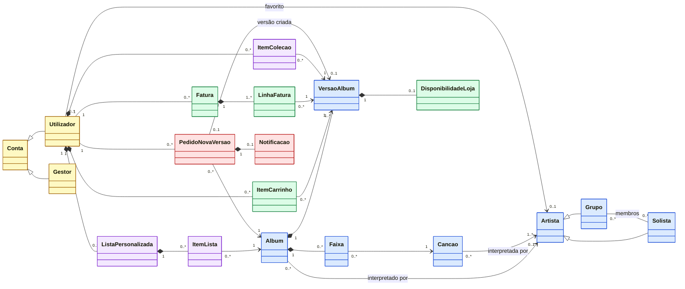
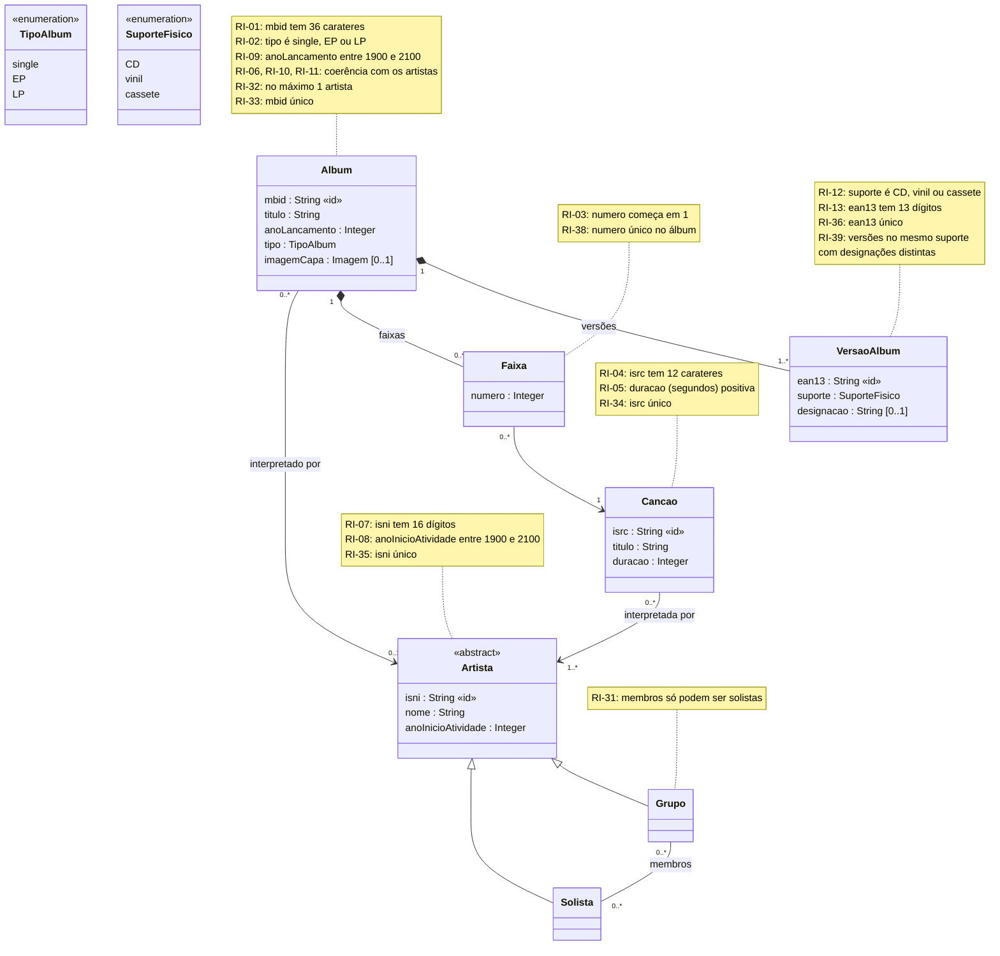
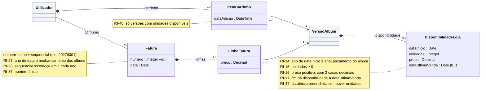
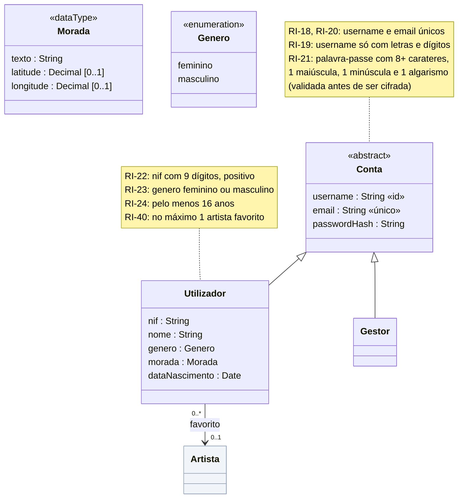
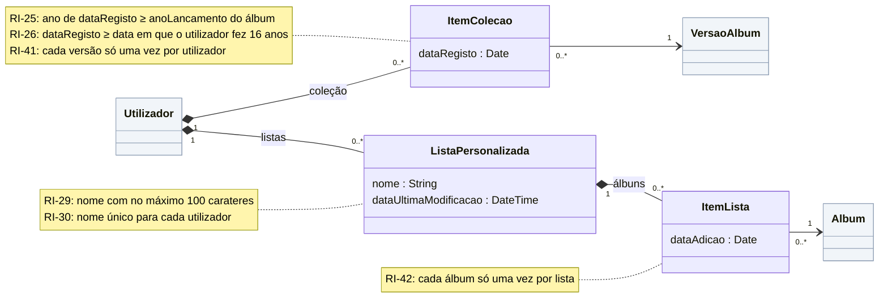
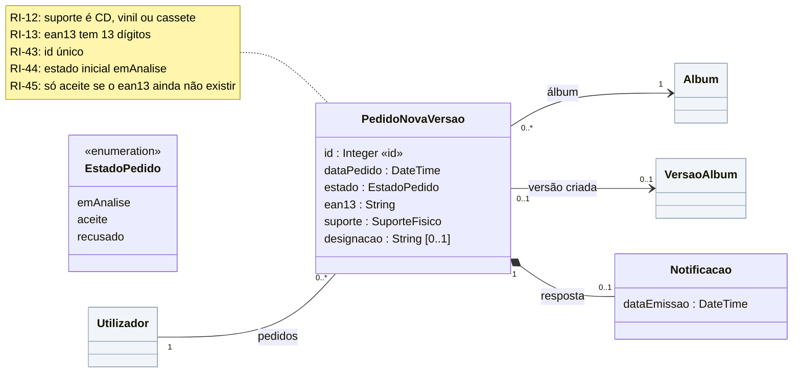

# Modelo de dados: diagrama de classes

**Responsável:** Rodrigo · **Versão:** v1 (30/out) · Os nomes seguem o [glossário](glossario.md).

Os diagramas estão escritos em Mermaid: aparecem desenhados diretamente no GitHub. Para os passar para o draw.io: **Organizar → Inserir → Avançado → Mermaid**, colar o código do bloco e depois ajustar o layout e exportar em PNG/PDF para o relatório.

**Notação usada:**
- `«id»` = identificador (único); `«único»` = valor único mas não é o identificador.
- `[0..1]` = atributo opcional.
- Seta simples (`-->`) = associação navegável; losango cheio (`*--`) = composição (a parte não existe sem o todo); triângulo (`<|--`) = generalização.
- As restrições de integridade (RI-xx) aparecem em notas junto à classe a que se aplicam.

---

## 1. Diagrama de topo

Só classes e associações, sem atributos. As cores identificam os 5 agrupamentos.

| Cor | Agrupamento |
|---|---|
| 🟦 Azul | Catálogo |
| 🟩 Verde | Loja e vendas |
| 🟨 Amarelo | Utilizadores |
| 🟪 Roxo | Coleções e listas |
| 🟥 Vermelho | Pedidos |

---

## 2. Catálogo

Artistas, álbuns, canções, faixas e versões físicas.

**Restrições que envolvem várias classes (descritas no relatório, não cabem como nota):**
- **RI-06:** se o álbum tem artista, esse artista interpreta todas as canções das faixas do álbum.
- **RI-10:** `Album.anoLancamento` ≥ `anoInicioAtividade` do artista que o interpreta.
- **RI-11:** `Album.anoLancamento` ≥ `anoInicioAtividade` de todos os artistas das canções das faixas.

---

## 3. Loja e vendas

Stock e preço de cada versão, carrinho e faturas.

As classes a cinzento pertencem a outros agrupamentos e aparecem só para mostrar as ligações.

---

## 4. Utilizadores

Contas de acesso, dados pessoais e artista favorito.

---

## 5. Coleções e listas

A coleção guarda **versões** (o que o utilizador tem fisicamente); as listas guardam **álbuns** (independentemente da versão).

---

## 6. Pedidos

Pedidos de novas versões e respetivas notificações.

---

## 7. Decisões de modelação (para a secção "Modelo de dados" do relatório)

1. **Solista e Grupo como subclasses de Artista.** A associação `membros` liga `Grupo` a `Solista`, por isso o próprio modelo impede que um grupo tenha grupos como membros (ou a si próprio). A multiplicidade é `0..*` porque o registo de membros é uma funcionalidade extra (nota 11 do enunciado).
2. **Faixa como classe própria.** A mesma canção pode estar em vários álbuns (ex.: "Last Resort" em "Infest" e em "Now 4"), e o número da faixa depende do álbum. `Faixa` liga um álbum a uma canção numa posição.
3. **Álbum com `0..1` artista.** As compilações não têm artista (nota 10); a aplicação mostra "Vários artistas".
4. **Álbum com `0..*` faixas.** Nenhuma user story obrigatória regista canções (US22 regista o álbum sem faixas), por isso um álbum pode existir sem faixas até elas serem importadas (pergunta P4 ao professor).
5. **VersaoAlbum separada de Album.** O que se compra, coleciona e põe no carrinho é uma versão concreta (identificada pelo EAN-13), não o álbum abstrato.
6. **DisponibilidadeLoja separada de VersaoAlbum (`0..1`).** Distingue as três situações da US9: nunca esteve na loja (não existe), está disponível (`unidades > 0`) e esgotou (`unidades = 0` e `dataUltimaVenda` preenchida).
7. **LinhaFatura guarda o preço.** O preço da versão pode mudar depois; a fatura tem de guardar o preço pago.
8. **Coleção guarda versões, listas guardam álbuns.** É o que dizem a US10 ("adicionar uma versão à coleção") e a US15/US17 ("listas de álbuns, independentemente das versões").
9. **Conta como superclasse de Utilizador e Gestor.** Ambos iniciam sessão com username e palavra-passe; só o utilizador tem dados pessoais, coleção, listas, carrinho e pedidos.
10. **Morada como tipo de dados com coordenadas opcionais.** O enunciado pede coordenadas, mas a US3 só mostra o mapa "se for possível" geocodificar a morada.
11. **A palavra-passe é guardada cifrada (`passwordHash`).** Segue a RNF-12. A US3 pede para a mostrar no perfil, o que não é possível depois de cifrada (pergunta P3 ao professor); proposta: mostrar mascarada.
12. **Notificação ligada ao pedido.** O destinatário é o utilizador do pedido e a resposta é o estado do pedido, por isso não se repetem esses dados.
13. **Pedido aceite liga-se à versão criada.** Quando o gestor aceita (US24 c), cria-se uma `VersaoAlbum` com os dados do pedido e fica registada a ligação.

## 8. Pontos para alinhar com a equipa

**Restrições novas (RI-31 a RI-47).** Estão definidas, com a origem de cada uma, em [`etapa1/servicos/restricoes.md`](../servicos/restricoes.md), e já aparecem nas notas dos diagramas acima.

**Com todos (suposições a confirmar):**
- O carrinho e as faturas não têm quantidade: cada linha é uma unidade de uma versão, porque o enunciado não fala em quantidades.
- O nome do estado é `recusado` (US13/US14) e não `rejeitado` (US24), até o professor responder (P2).
