# Introdução

Este relatório apresenta a primeira etapa do projeto de Planeamento e Gestão de Projeto de 2026/2027: o desenho inicial e a pesquisa de tecnologias de uma aplicação web para a **gestão de coleções de álbuns de música em formato físico**, integrada no contexto de uma loja de música. A aplicação permite aos utilizadores gerir a sua coleção, comprar álbuns na loja e manter listas personalizadas; ao gestor da loja permite gerir o catálogo, o stock e os pedidos dos utilizadores.

A aplicação segue uma arquitetura cliente-servidor com três camadas (frontend, backend e base de dados). A equipa optou pela stack sugerida no enunciado, MEAN: Angular no frontend, Express e Node.js no backend e MongoDB na base de dados. Será desenvolvida no próximo semestre, em PTIR, com o modelo de processo Scrum.

O relatório está organizado da seguinte forma:

- **Capítulo 2:** casos de uso, com os atores e as funcionalidades da aplicação.
- **Capítulo 3:** modelo de dados (diagrama de classes) e restrições de integridade.
- **Capítulo 4:** fluxos de trabalho (diagramas de atividades).
- **Capítulo 5:** esboços da interface com o utilizador.
- **Capítulo 6:** pesquisa de serviços externos (mapas, geocodificação e pagamentos).
- **Capítulo 7:** suposições feitas pela equipa e questões em aberto.

Os diagramas seguem a notação UML. Todos os artefactos estão também disponíveis no repositório do projeto.

# Casos de uso

Os diagramas de casos de uso mostram, numa perspetiva de alto nível, as funcionalidades da aplicação web e os atores que as usam.

## Atores

Há dois atores humanos, como define o enunciado, e três sistemas externos, escolhidos na pesquisa de serviços (capítulo 6).

**Tabela 1 — Atores**

| Ator | Tipo | Descrição |
|---|---|---|
| Utilizador | Humano | Colecionador de álbuns e potencial cliente da loja. |
| Gestor | Humano | Gestor da loja de música. A conta já existe pré-configurada. |
| Serviço de Geocodificação (Nominatim) | Sistema externo | Converte a morada do utilizador em coordenadas, quando cria a conta ou altera o perfil. |
| Serviço de Mapas (Leaflet + OpenStreetMap) | Sistema externo | Mostra a morada no perfil e as moradas dos maiores colecionadores nas estatísticas. |
| Serviço de Pagamentos (Stripe / PayPal) | Sistema externo | Processa o pagamento do carrinho de compras. |

## Diagramas de casos de uso

As 29 user stories foram agrupadas em 21 casos de uso. User stories que atuam sobre os mesmos dados ficaram num só caso de uso: por exemplo, "Gerir coleção" junta adicionar uma versão à coleção (US10) e ver, ordenar e remover álbuns da coleção (US11).

Com 21 casos de uso, um só diagrama ficava com muitas linhas cruzadas e difícil de ler. Por isso foram feitos dois diagramas, um por ator humano. Os casos de uso "Iniciar sessão" (UC-02) e "Visualizar página de álbum" (UC-09) são comuns aos dois. Há duas relações entre casos de uso: **UC-08 «extend» UC-07**, porque gerir o artista favorito é uma opção dentro da página do artista (US7 a); e **UC-20 «extend» UC-09**, porque o gestor altera as unidades a partir da página do álbum (US25 a), por isso gerir o stock é uma extensão dessa página.

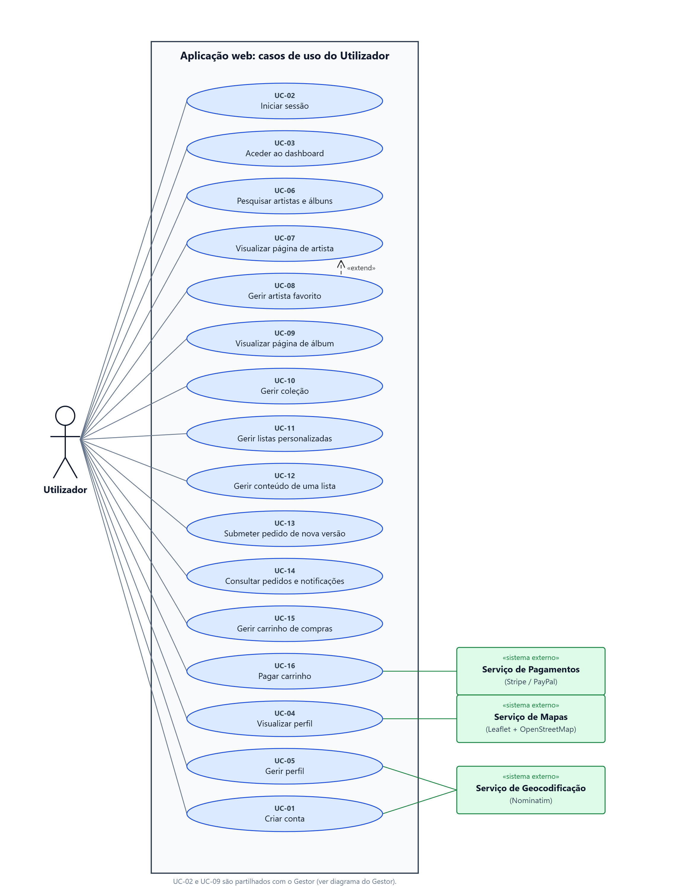

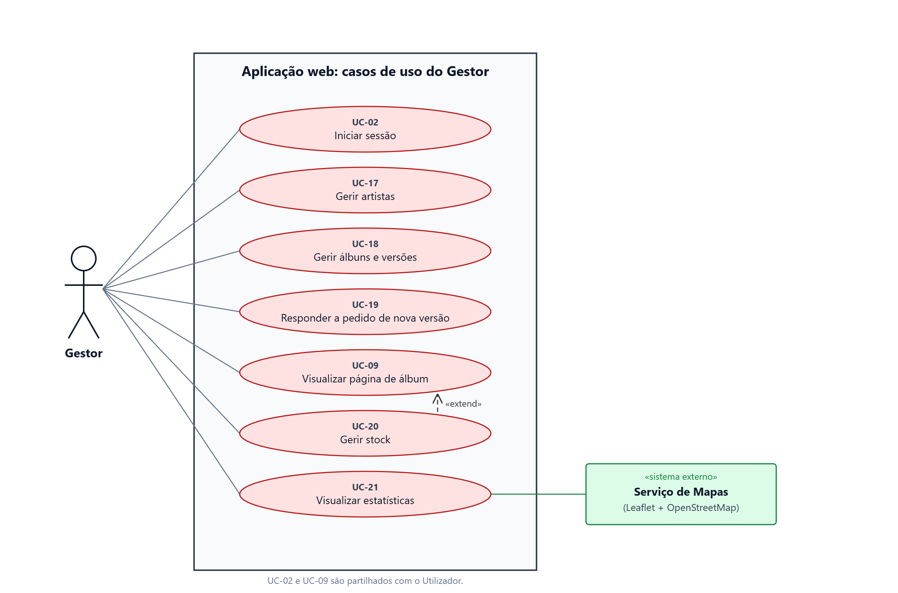

## Lista de casos de uso

**Tabela 2 — Casos de uso e user stories correspondentes**

| ID | Caso de uso | Atores | User stories |
|---|---|---|---|
| UC-01 | Criar conta | Utilizador, Serviço de Geocodificação | US1 |
| UC-02 | Iniciar sessão | Utilizador, Gestor | US2 |
| UC-03 | Aceder ao dashboard | Utilizador | US19 |
| UC-04 | Visualizar perfil | Utilizador, Serviço de Mapas | US3 |
| UC-05 | Gerir perfil | Utilizador, Serviço de Geocodificação | US4 |
| UC-06 | Pesquisar artistas e álbuns | Utilizador | US5, US8 |
| UC-07 | Visualizar página de artista | Utilizador | US6 |
| UC-08 | Gerir artista favorito | Utilizador | US7 |
| UC-09 | Visualizar página de álbum | Utilizador, Gestor | US9, US25 a) |
| UC-10 | Gerir coleção | Utilizador | US10, US11 |
| UC-11 | Gerir listas personalizadas | Utilizador | US15, US16 |
| UC-12 | Gerir conteúdo de uma lista | Utilizador | US17, US18 |
| UC-13 | Submeter pedido de nova versão | Utilizador | US12 |
| UC-14 | Consultar pedidos e notificações | Utilizador | US13, US14 |
| UC-15 | Gerir carrinho de compras | Utilizador | US26, US27 |
| UC-16 | Pagar carrinho | Utilizador, Serviço de Pagamentos | US28 |
| UC-17 | Gerir artistas | Gestor | US20, US21 |
| UC-18 | Gerir álbuns e versões | Gestor | US22, US23 |
| UC-19 | Responder a pedido de nova versão | Gestor | US24 |
| UC-20 | Gerir stock («extend» UC-09) | Gestor | US25 |
| UC-21 | Visualizar estatísticas | Gestor, Serviço de Mapas | US29 |

As 29 user stories do enunciado estão todas associadas a um caso de uso.

# Modelo de dados

O modelo de dados define a informação que a aplicação web tem de guardar de forma persistente: as classes, os seus atributos, as associações entre elas e as restrições de integridade. Foi construído a partir do universo do discurso do enunciado, das restrições de integridade RI-01 a RI-30 e dos dados que as user stories precisam de mostrar ou alterar.

Como o modelo completo não cabe numa página A4, foi dividido em cinco agrupamentos lógicos. A Figura 3 mostra a visão geral, só com classes e associações e os agrupamentos identificados por cores. As Figuras 4 a 8 mostram cada agrupamento com os atributos e as restrições de integridade.

## Visão geral

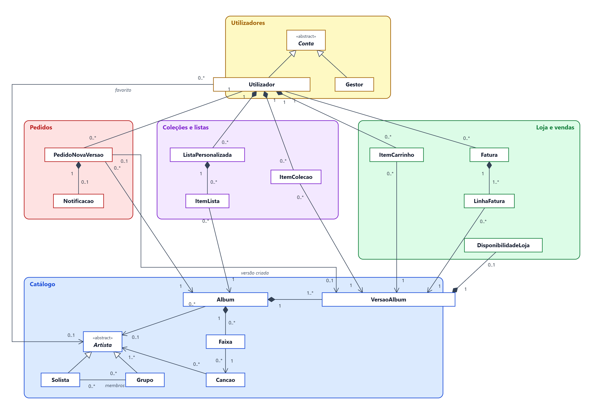

**Tabela 3 — Agrupamentos do modelo de dados**

| Cor | Agrupamento | Classes |
|---|---|---|
| Azul | Catálogo | Artista, Solista, Grupo, Album, Cancao, Faixa, VersaoAlbum |
| Verde | Loja e vendas | DisponibilidadeLoja, ItemCarrinho, Fatura, LinhaFatura |
| Amarelo | Utilizadores | Conta, Utilizador, Gestor |
| Roxo | Coleções e listas | ItemColecao, ListaPersonalizada, ItemLista |
| Vermelho | Pedidos | PedidoNovaVersao, Notificacao |

A classe central do modelo é a **VersaoAlbum**: a versão concreta de um álbum num suporte físico, identificada pelo código EAN-13. É ela que o utilizador compra, coloca no carrinho e adiciona à coleção, e é a ela que se associam o stock e o preço na loja.

## Catálogo

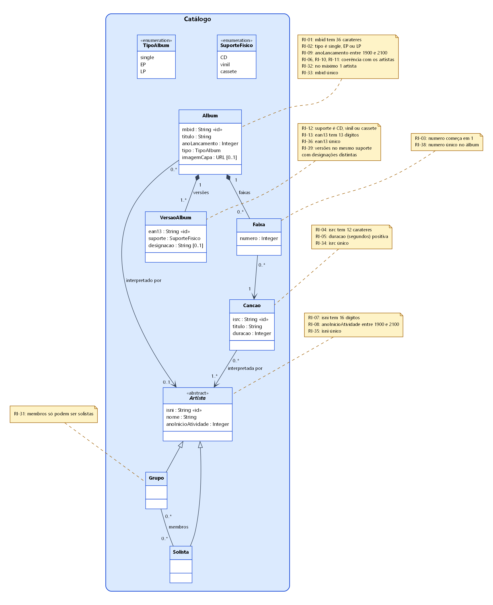

- **Artista** é uma classe abstrata com duas especializações, **Solista** e **Grupo**. Os membros de um grupo são representados pela associação `membros` entre Grupo e Solista; como esta associação só liga grupos a solistas, o próprio modelo garante que um grupo não pode ter outros grupos como membros, nem a si próprio.
- **Album** é interpretado por no máximo um artista. Os álbuns de compilação não têm artista associado e a aplicação mostra um texto por omissão, como "Vários artistas".
- **Cancao** é interpretada por um ou mais artistas e pode aparecer em vários álbuns. Por isso, a posição de uma canção num álbum é representada pela classe **Faixa**, que tem o número de ordem e liga um álbum a uma canção.
- **VersaoAlbum** representa o álbum num suporte físico (CD, vinil ou cassete) e numa versão com designação própria, por exemplo a cor do vinil. Cada álbum tem uma ou mais versões.

## Loja e vendas

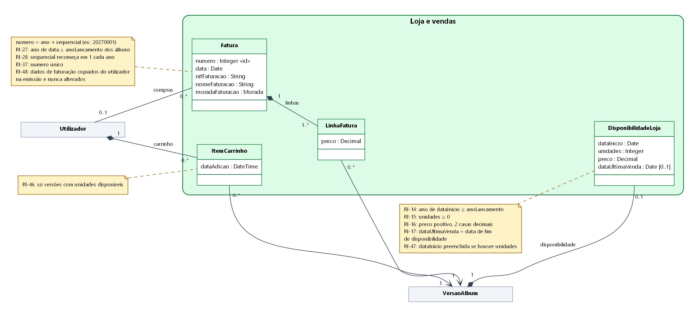

- **DisponibilidadeLoja** guarda, para cada versão que alguma vez esteve à venda, a data em que ficou disponível, o número de unidades, o preço e, quando esgota, a data da última venda. Esta data da última venda é a "data de fim de disponibilidade" referida na RI-17: só é preenchida quando a versão esgota. Por ser opcional, distingue as três situações mostradas na página do álbum (US9): nunca esteve na loja, está disponível ou esgotou.
- **ItemCarrinho** representa uma versão colocada no carrinho, com a data de adição, para mostrar os itens mais recentes primeiro (US27).
- **Fatura** é emitida quando o pagamento no serviço externo tem sucesso (US28). O número tem o ano seguido de um sequencial que recomeça em cada ano (por exemplo, 20270001). Cada fatura tem uma ou mais **LinhaFatura**, que guardam o preço pago por cada versão, porque o preço na loja pode mudar depois da compra.
- A fatura guarda também uma **cópia dos dados de faturação** do utilizador (NIF, nome e morada), que a US28 d) exige na fatura. Estes dados ficam fixos no momento da emissão (RI-48): não mudam se o utilizador alterar o perfil, e a fatura mantém-se se o utilizador apagar a conta (RNF-16). Por isso, do lado da fatura, a ligação ao utilizador é opcional (0..1).

## Utilizadores

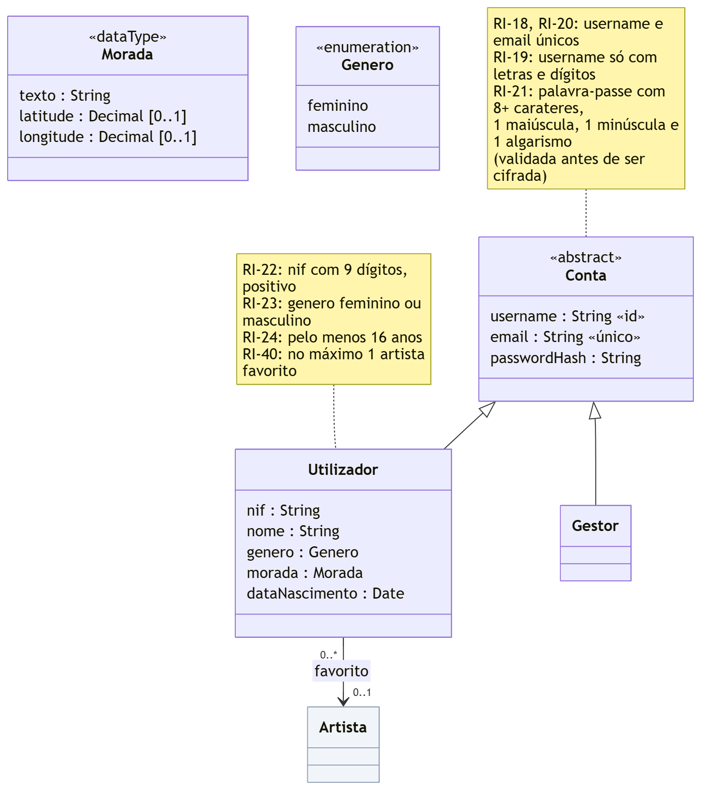

- **Conta** é uma classe abstrata com os dados de acesso comuns: username, e-mail e palavra-passe. A palavra-passe é guardada cifrada, como recomenda a RNF-12.
- **Utilizador** acrescenta os dados pessoais: NIF, nome, género, morada e data de nascimento. A **Morada** é um tipo de dados com o texto e as coordenadas geográficas, opcionais porque só existem quando o serviço de geocodificação consegue converter a morada (US3).
- **Gestor** representa a conta do gestor da loja, que já existe pré-configurada.
- Cada utilizador pode ter no máximo um artista favorito (US7).

## Coleções e listas

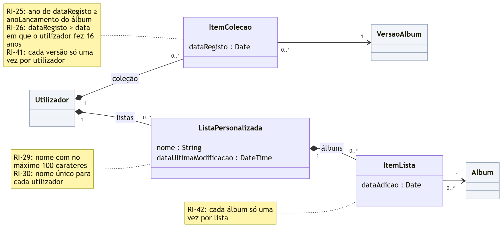

- **ItemColecao** regista uma versão que o utilizador tem, com a data de registo. Os itens são criados por adição manual (US10) ou automaticamente depois de uma compra (US28). Neste último caso, o item fica ligado à **LinhaFatura** de origem (associação opcional `origem`), o que permite distinguir os álbuns comprados na loja dos adicionados à mão, por exemplo nas estatísticas (US29).
- **ListaPersonalizada** tem um nome e a data da última modificação. Cada **ItemLista** liga a lista a um **álbum**, e não a uma versão, com a data de adição, porque as listas organizam álbuns independentemente das versões (US15, US17).

## Pedidos

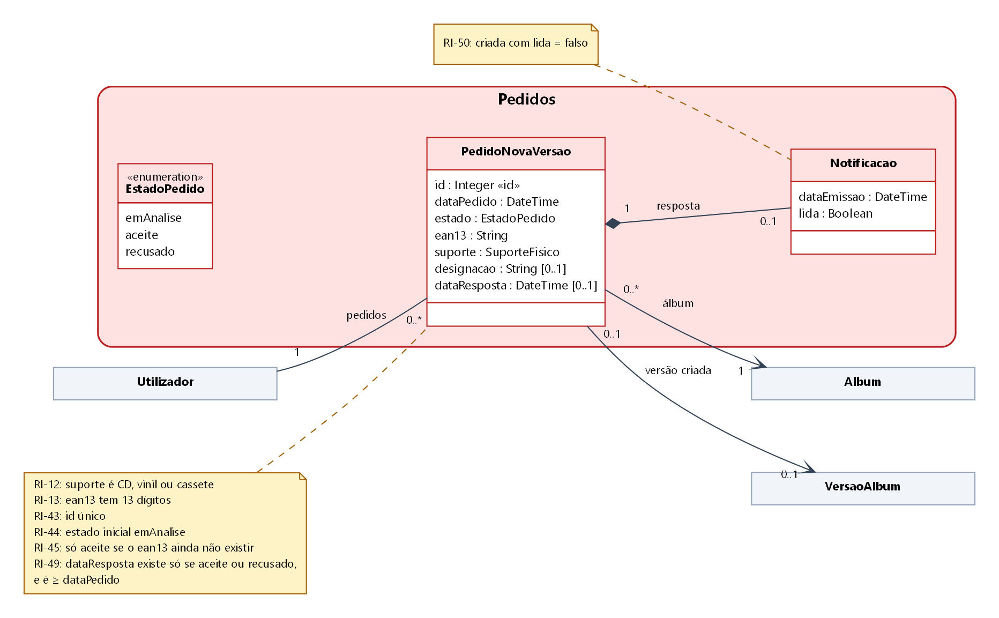

- **PedidoNovaVersao** guarda o pedido de um utilizador para acrescentar uma versão a um álbum existente: identificador, data, estado, data de resposta e dados da versão pedida (EAN-13, suporte físico e designação). A data de resposta só é preenchida quando o gestor aceita ou recusa o pedido (RI-49).
- O estado é "em análise" quando o pedido é criado e passa a "aceite" ou "recusado" quando o gestor responde (US24). Quando o pedido é aceite, é criada uma nova VersaoAlbum, que fica associada ao pedido.
- **Notificacao** é criada quando o pedido é respondido (US14). Está ligada ao pedido, de onde se obtêm o destinatário e a resposta. O atributo `lida` permite mostrar no sino do dashboard o número de notificações por ler; uma notificação nova começa como não lida (RI-50).

## Principais decisões de modelação

**Tabela 4 — Decisões de modelação**

| Decisão | Justificação |
|---|---|
| Solista e Grupo como subclasses de Artista | O modelo impede, por construção, que um grupo tenha grupos como membros. |
| Faixa como classe própria | A mesma canção pode estar em vários álbuns, com números de faixa diferentes. |
| Álbum com no máximo um artista | Os álbuns de compilação não têm artista (nota 10 do enunciado). |
| Álbum pode não ter faixas | O registo de álbuns (US22) não inclui as canções, que podem ser importadas mais tarde. |
| VersaoAlbum separada de Album | O que se compra, coleciona e põe no carrinho é uma versão concreta, identificada pelo EAN-13. |
| DisponibilidadeLoja separada e opcional | Distingue "nunca esteve na loja", "disponível" e "esgotado" (US9). |
| Preço guardado na LinhaFatura | A fatura mantém o preço pago, mesmo que o preço na loja mude. |
| A coleção guarda versões e as listas guardam álbuns | Segue a US10 e as US15 e US17. |
| Conta como superclasse de Utilizador e Gestor | Ambos iniciam sessão; só o utilizador tem dados pessoais, coleção e compras. |
| Palavra-passe cifrada | RNF-12; no perfil (US3) a palavra-passe é mostrada mascarada. |
| Notificação ligada ao pedido | Evita repetir o destinatário e a resposta, que já estão no pedido. |
| Cópia dos dados de faturação na Fatura | A US28 d) exige os dados do utilizador na fatura, e estes não podem mudar se o perfil for alterado ou a conta apagada (RNF-16). |
| Utilizador 0..1 do lado da Fatura | Permite apagar a conta mantendo as faturas, que têm de ser conservadas. |
| Notificacao com o atributo `lida` | Necessário para o contador de notificações por ler no dashboard (US14 a). |
| PedidoNovaVersao com `dataResposta` | Regista quando o gestor respondeu ao pedido (US24). |
| ItemColecao ligado à LinhaFatura de origem | Distingue os itens comprados na loja dos adicionados à mão (útil na US29). |
| `dataUltimaVenda` como data de fim de disponibilidade | É a data referida na RI-17; só existe quando a versão esgota. |

## Restrições de integridade

As restrições RI-01 a RI-30 do enunciado estão representadas nas notas das classes a que se aplicam (Figuras 4 a 8). As que envolvem várias classes são:

- **RI-06:** se um álbum é interpretado por um artista, esse artista interpreta todas as canções das faixas do álbum.
- **RI-10 e RI-11:** o ano de lançamento de um álbum é igual ou posterior ao ano de início de atividade do artista que o interpreta e de todos os artistas das canções das suas faixas.
- **RI-14, RI-25 e RI-27:** as datas de disponibilidade, de adição à coleção e das faturas não podem ser anteriores ao ano de lançamento do álbum.

Foram ainda identificadas 21 restrições novas, a partir do universo do discurso, das notas de rodapé e dos critérios de aceitação das user stories. O Anexo A associa todas as restrições às classes do modelo.

**Tabela 5 — Restrições de integridade novas**

| ID | Restrição | Origem |
|---|---|---|
| RI-31 | Os membros de um grupo só podem ser artistas solistas: um grupo não pode ter como membros outros grupos, nem a si próprio. | Universo do discurso |
| RI-32 | Um álbum é interpretado por, no máximo, um artista. | Universo do discurso, nota 10 |
| RI-33 | O código MBID identifica univocamente um álbum. | Universo do discurso |
| RI-34 | O código ISRC identifica univocamente uma canção. | Universo do discurso |
| RI-35 | O código ISNI identifica univocamente um artista. | Universo do discurso |
| RI-36 | O código EAN-13 identifica univocamente uma versão de um álbum. | Universo do discurso |
| RI-37 | O número de uma fatura identifica univocamente a fatura. | Nota 7 |
| RI-38 | O número de faixa é único dentro de cada álbum. | Universo do discurso |
| RI-39 | Se um álbum tiver mais do que uma versão no mesmo suporte físico, todas têm designação, e as designações são diferentes. | Universo do discurso, US9 c) |
| RI-40 | Um utilizador tem, no máximo, um artista favorito. | US7 c) |
| RI-41 | Uma versão só pode constar uma vez na coleção de um utilizador. | US10 c) |
| RI-42 | Um álbum só pode constar uma vez em cada lista personalizada. | US17 c) |
| RI-43 | O identificador de um pedido de nova versão é único. | US13 c) |
| RI-44 | O estado de um pedido só pode ser "em análise", "aceite" ou "recusado", e o estado inicial é "em análise". | US12 d), US13 d), US24 b) |
| RI-45 | Um pedido só pode ser aceite se o EAN-13 pedido não corresponder a uma versão já existente. | US24 c) |
| RI-46 | Só pode ser colocada no carrinho uma versão disponível na loja (com unidades maiores que zero). | US26 a) |
| RI-47 | Quando uma versão é registada com unidades maiores que zero, a data de início de disponibilidade tem de estar preenchida. | US22 g), US25 b) |
| RI-48 | Os dados de faturação (NIF, nome e morada) são copiados do utilizador na emissão da fatura e não são alterados depois. | US28 d), RNF-16 |
| RI-49 | A data de resposta de um pedido existe se e só se o estado for "aceite" ou "recusado", e é igual ou posterior à data do pedido. | US24 c) e d) |
| RI-50 | Uma notificação é criada como não lida. | US14 a) |
| RI-51 | Um item da coleção com origem numa linha de fatura refere-se à mesma versão, pertence ao utilizador da fatura e tem como data de registo a data da fatura. | US28 d) |

# Fluxos de trabalho

Os diagramas de atividades mostram os passos dos fluxos de trabalho que a aplicação web tem de suportar e quem executa cada passo. Seguem a notação UML: cada diagrama começa num nó inicial (círculo preto) e termina num nó final (anel com ponto); as decisões e os pontos onde os fluxos se juntam (merge) são losangos vazios, com as condições nas guardas `[ ]` das setas; as barras pretas são fork e join, e marcam ações que correm em paralelo. Cada diagrama está dividido em raias (swimlanes), uma por ator: o utilizador, o gestor da loja, a aplicação web e os serviços externos.

Foram escolhidos os fluxos que envolvem vários atores ou várias user stories, porque são os mais difíceis de implementar. O fluxo de compra, o mais complexo, foi representado num diagrama de alto nível, com o pagamento decomposto num diagrama de subatividade.

**Tabela 6 — Diagramas de atividades**

| Figura | Fluxo | User stories |
|---|---|---|
| 9 | Comprar álbuns (alto nível) | US8, US9, US26, US27, US28 |
| 10 | Pagar o carrinho (subatividade) | US28 |
| 11 | Pedido de nova versão de um álbum | US9, US10, US12, US13, US14, US24 |
| 12 | Criar conta e iniciar sessão | US1, US2, US19 |
| 13 | Gerir o catálogo | US20, US22, US25 |

## Comprar álbuns

O utilizador pesquisa um álbum, abre a sua página, escolhe uma versão e, se estiver disponível na loja, coloca-a no carrinho. Pode repetir estes passos para vários álbuns e remover itens antes de pagar.

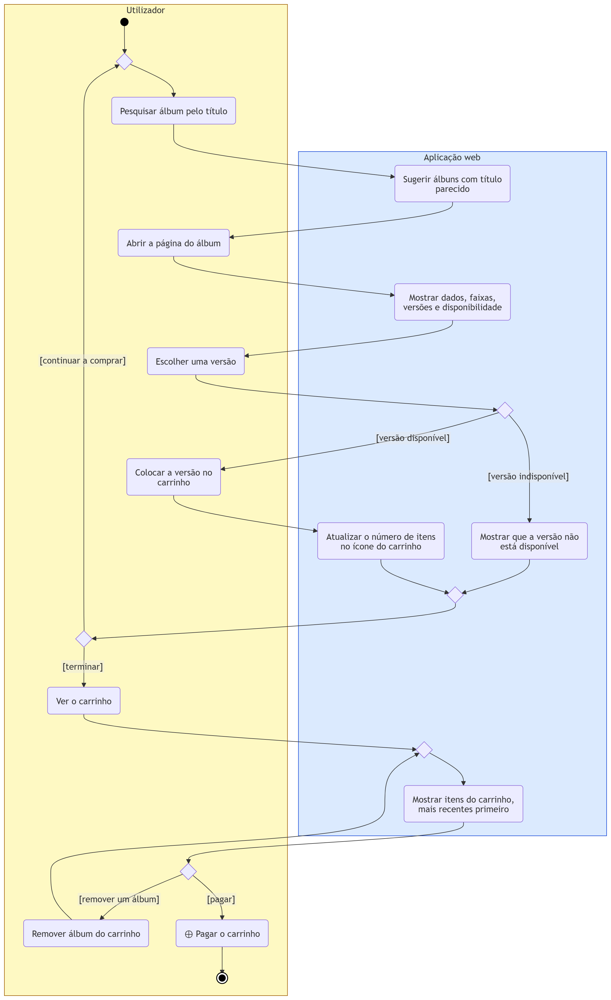

O pagamento (Figura 10) envolve o serviço externo escolhido pelo utilizador, Stripe ou PayPal:

1. Antes de pagar, a aplicação verifica e **reserva as unidades** das versões do carrinho. Se entretanto outro utilizador tiver comprado a última unidade de alguma versão, essa versão é retirada do carrinho e o utilizador é avisado.
2. O utilizador escolhe o serviço; a aplicação calcula o total e inicia o pagamento. O utilizador introduz os dados de pagamento na página do serviço, pelo que a aplicação nunca trata os dados do cartão.
3. A aplicação espera pelo resultado enviado pelo serviço (US28 c). Se o pagamento for recusado ou não houver resposta dentro do **tempo limite**, a reserva é libertada e o utilizador pode tentar com outro serviço ou cancelar o pagamento (US28 g); cancelar é uma ação do utilizador.
4. Se o pagamento tiver sucesso, a aplicação emite a fatura com os dados de faturação e, **em paralelo** (fork/join), adiciona as versões à coleção do utilizador, ligadas às linhas da fatura, e confirma a saída das unidades reservadas. Se tiver sido vendida a última unidade de uma versão, regista a data da última venda (RI-17). No fim, esvazia o carrinho e mostra um resumo.

A fatura é emitida antes do fork porque os itens da coleção ficam ligados às linhas da fatura (RI-51); as duas ações seguintes são independentes.

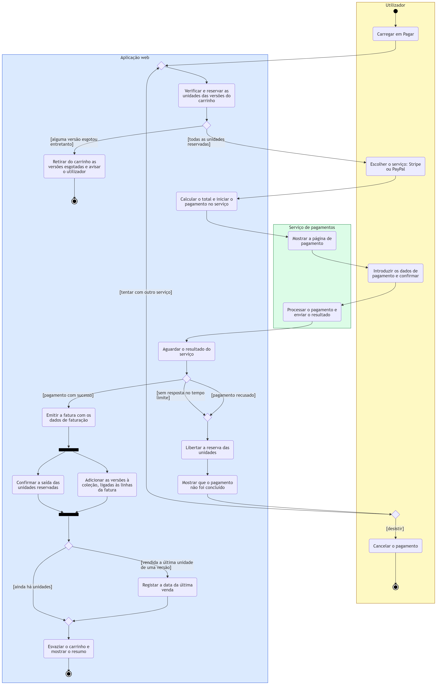

## Pedido de nova versão de um álbum

Este fluxo junta quatro user stories e três atores:

1. O utilizador escolhe um álbum e preenche os dados da nova versão. A aplicação valida o EAN-13 e o suporte físico e guarda o pedido com o estado "em análise" (US12).
2. O gestor abre o pedido e decide. Se a versão for nova e interessante para a loja, a aplicação cria a versão no álbum e muda o estado para "aceite"; caso contrário, muda-o para "recusado" (US24). Em ambos os casos regista a data de resposta (RI-49).
3. Em ambos os casos é criada uma notificação, por ler, que o utilizador vê no dashboard (US14).
4. Se o pedido foi aceite, a nova versão aparece na página do álbum e o utilizador pode adicioná-la à coleção (US9, US10).

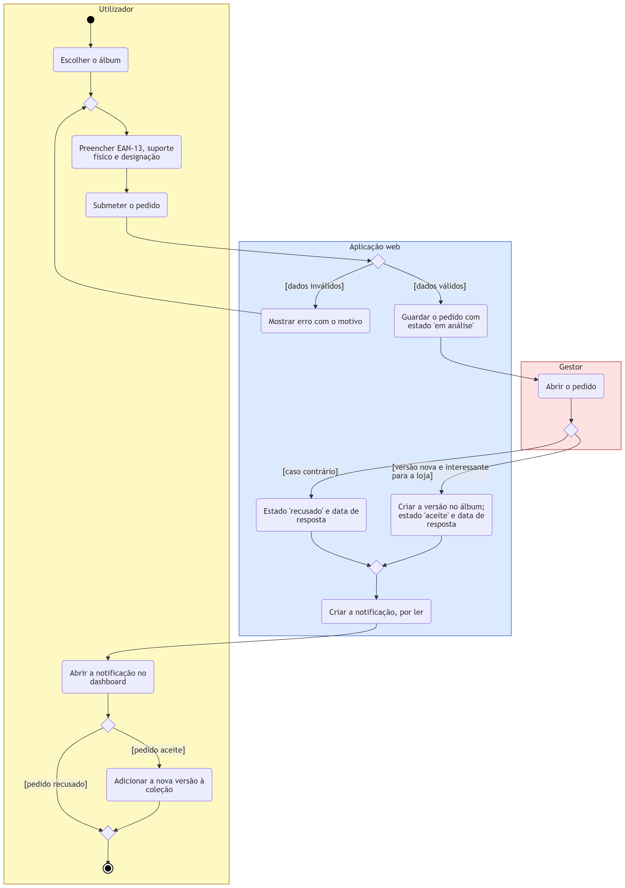

## Criar conta e iniciar sessão

Na criação de conta, a aplicação mostra os requisitos do username e da palavra-passe e valida os dados (RI-18 a RI-24). Se forem válidos, cifrar a palavra-passe e pedir as coordenadas da morada ao serviço de geocodificação são feitos em paralelo (fork/join), porque não dependem um do outro. Se a morada for encontrada, a conta é guardada com as coordenadas; caso contrário, é guardada sem elas, e o perfil não mostra o mapa (US3).

No início de sessão, se as credenciais estiverem erradas, a mensagem de erro é genérica e não revela se o username existe (US2 b). Se estiverem certas, a aplicação mostra o dashboard.

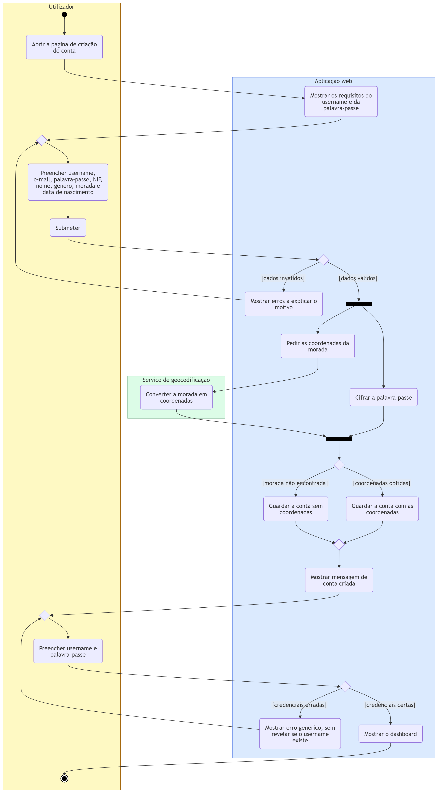

## Gerir o catálogo

O gestor regista o artista, se ainda não existir (US20). Depois regista um álbum novo, com a primeira versão, ou acrescenta uma versão a um álbum existente (US22). Se a versão for registada com unidades, a aplicação preenche automaticamente a data de início de disponibilidade (US22 g).

Mais tarde, na página do álbum, o gestor pode alterar as unidades de uma versão. Se for a primeira vez que essa versão é posta à venda, a aplicação pede o preço e regista a data de disponibilidade (US25 b).

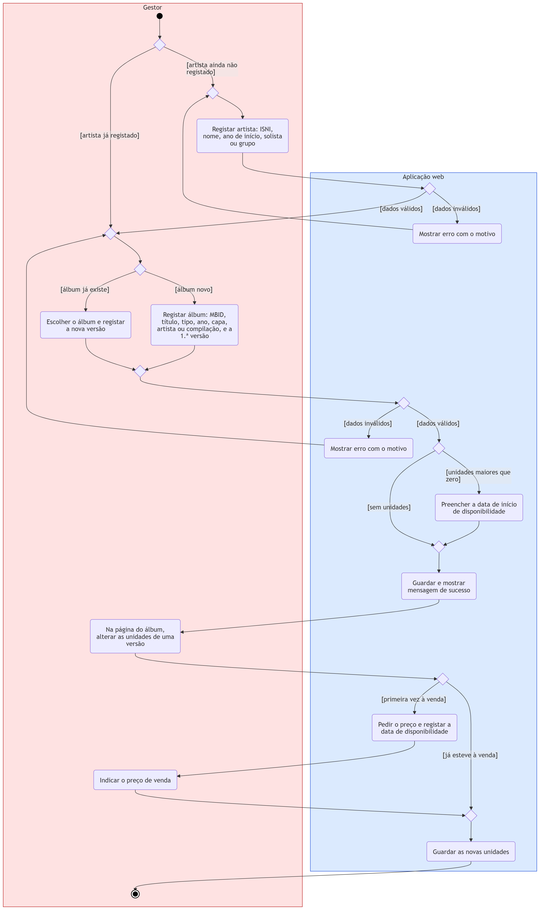

# Esboços da interface

Os esboços mostram como o utilizador e o gestor interagem com a aplicação, e ajudam a perceber a complexidade das user stories antes de as implementar. Como pede o enunciado, o foco está nas funcionalidades mais complexas: as que juntam várias user stories no mesmo ecrã ou envolvem serviços externos.

Os esboços são de baixa fidelidade: mostram a estrutura, os dados e as ações de cada ecrã, mas não o aspeto gráfico final. Cada esboço tem notas numeradas, a amarelo, que indicam a user story ou a restrição que justifica cada elemento.

## Página de álbum

É o ecrã mais complexo, porque junta cinco user stories. Mostra os dados do álbum, as faixas e uma tabela de versões. Para cada versão aparece o estado na loja: disponível, esgotada (com a data da última venda) ou "nunca esteve disponível". Os botões "Coleção" e "Carrinho" atuam sobre a versão, e o do carrinho só fica ativo se houver unidades. O gestor vê uma coluna adicional para alterar as unidades. O botão "Adicionar a uma lista" atua sobre o álbum, porque as listas guardam álbuns.

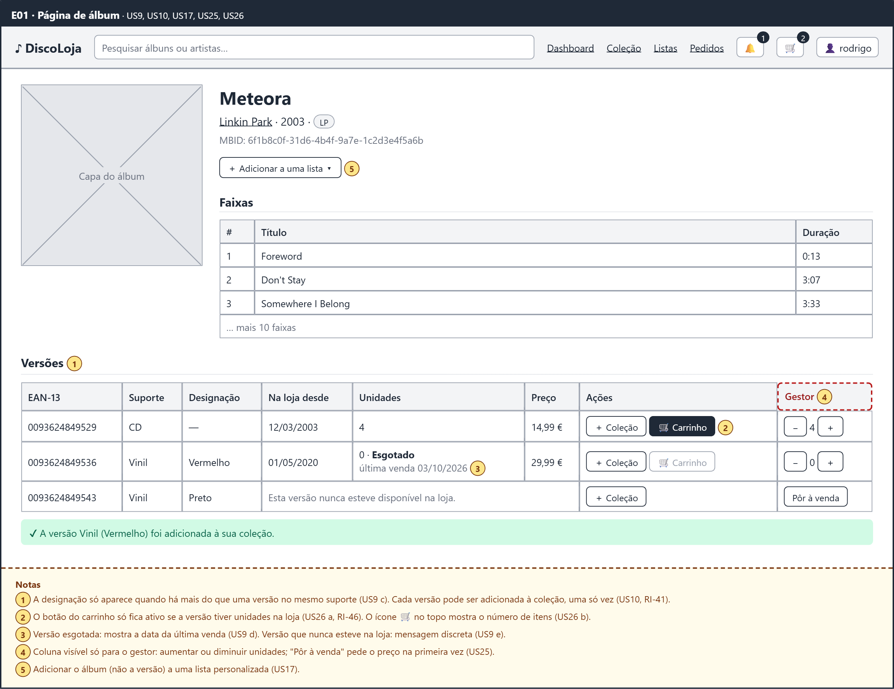

## Carrinho e pagamento

Os álbuns aparecem do mais recente para o mais antigo, com o total no fim. Ao pagar, o utilizador escolhe entre Stripe e PayPal e é redirecionado para a página segura do serviço. O esboço mostra também as mensagens de falha e de sucesso.

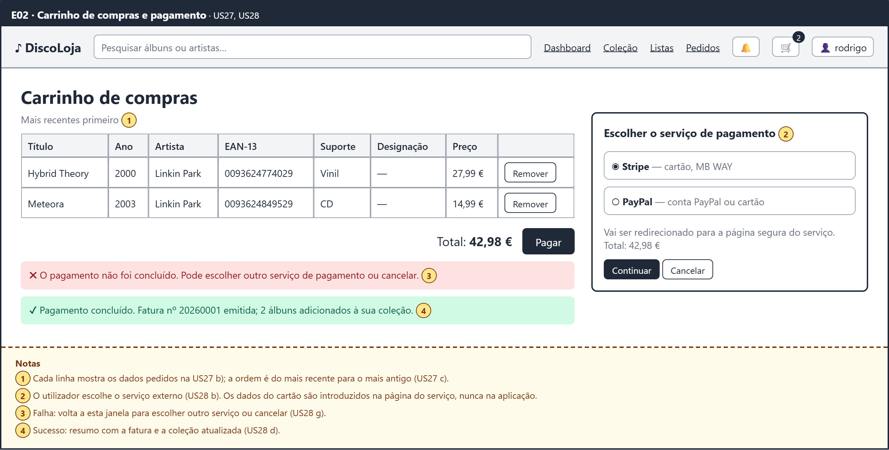

## Conta, perfil e pesquisa

Na criação de conta, os requisitos do username e da palavra-passe estão sempre visíveis e os erros aparecem junto ao campo. O campo da morada não tem sugestões automáticas, por causa da política de utilização do Nominatim. No perfil, a palavra-passe aparece mascarada e o mapa só aparece se a morada tiver coordenadas. Na pesquisa, um único campo serve para álbuns e artistas, com sugestões à medida que se escreve.

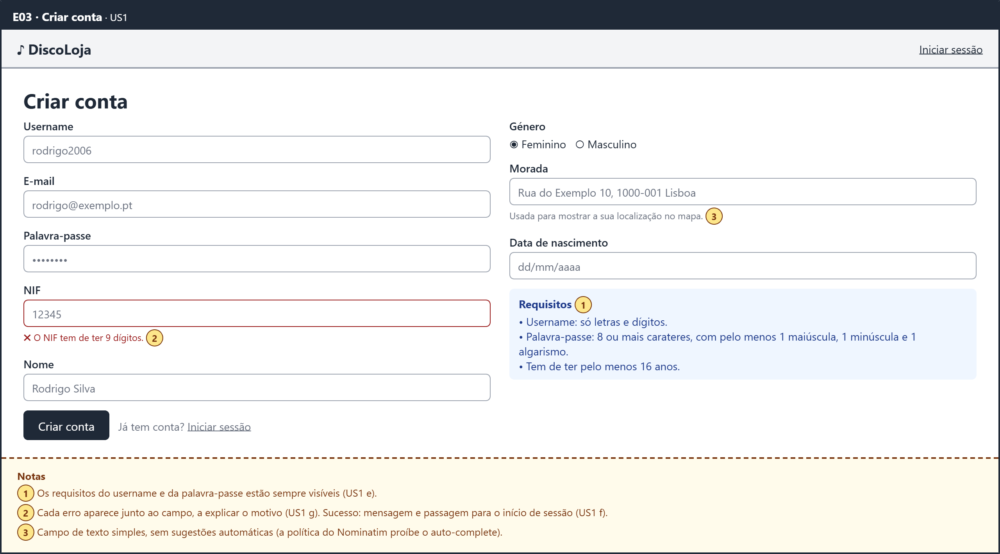

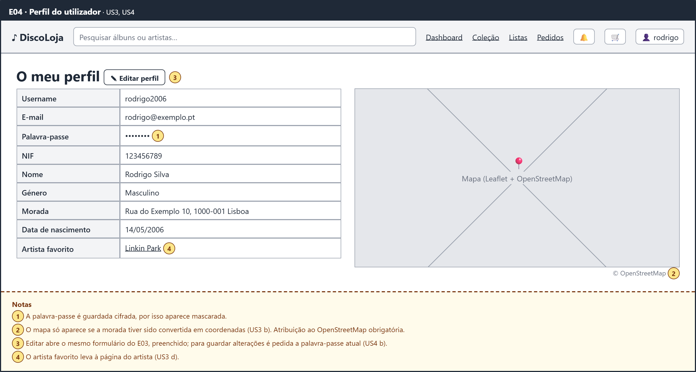

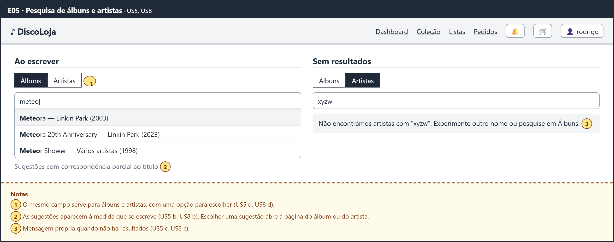

## Coleção, pedidos e dashboard

A coleção é uma tabela que se pode ordenar por qualquer coluna, com ligações para as páginas do álbum e do artista. A página de pedidos tem filtro por estado, um formulário para pedidos novos e o painel de notificações. O dashboard dá acesso a todas as funcionalidades do utilizador.

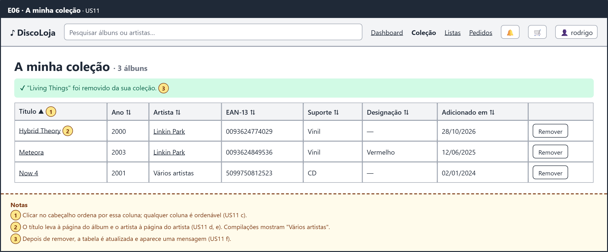

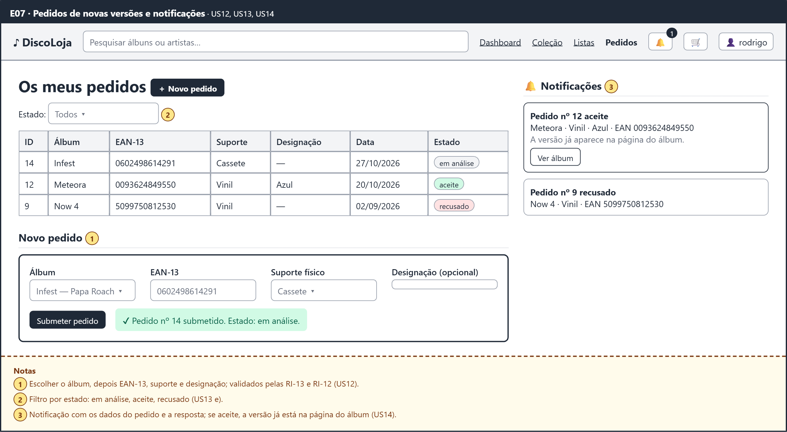

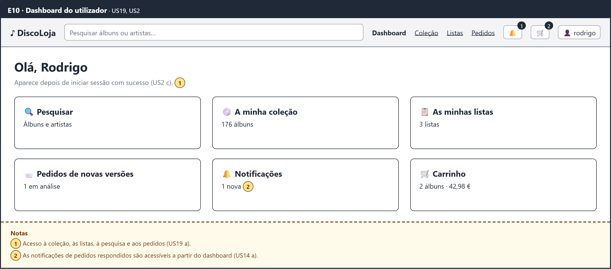

## Ecrãs do gestor

O formulário de registo alterna entre "novo álbum" e "nova versão de um álbum existente", e a data de disponibilidade é preenchida automaticamente quando há unidades. As estatísticas mostram as três tabelas pedidas na US29 e um mapa com as moradas dos cinco maiores colecionadores.

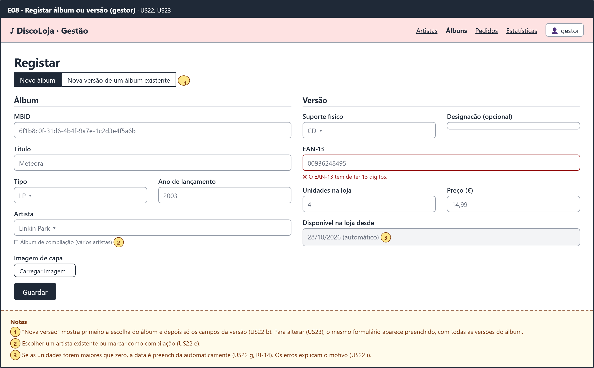

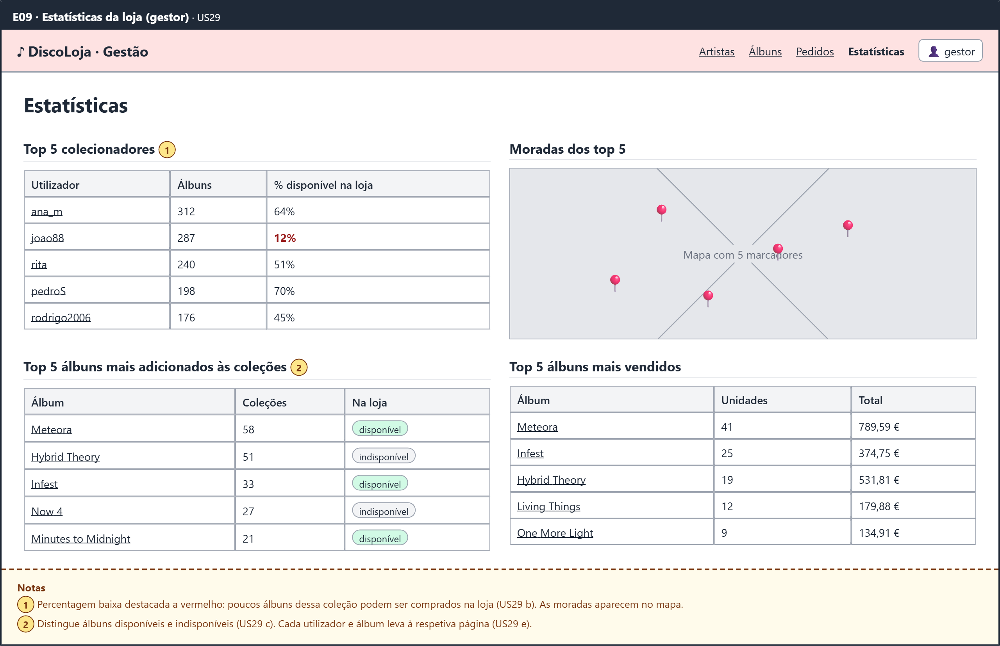

## Adaptação a telemóvel

Para cumprir a RNF-04, os dois ecrãs mais carregados foram também desenhados para telemóvel: as tabelas passam a cartões empilhados, as faixas ficam numa secção que se expande e o total do carrinho fica numa barra fixa no fundo do ecrã.

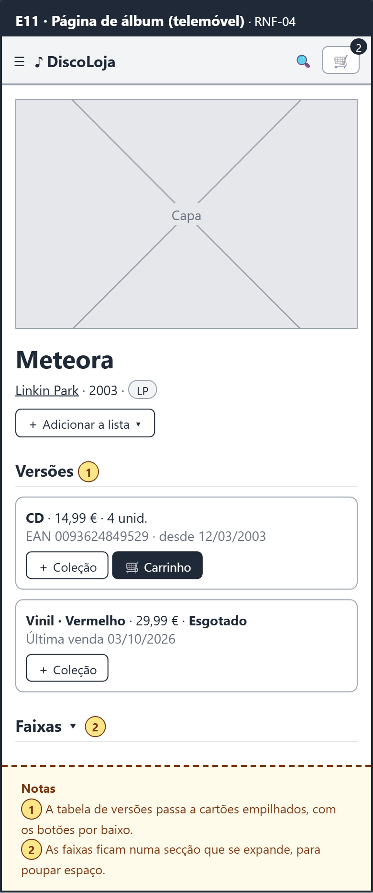

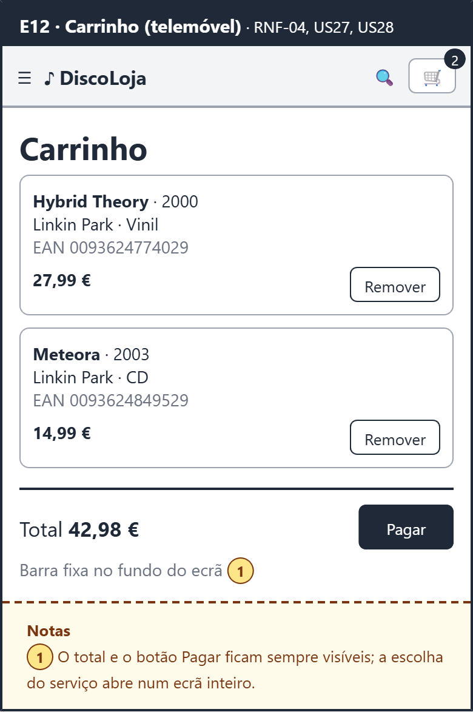

# Pesquisa de serviços externos

A aplicação precisa de três serviços externos. Para cada um foram comparadas alternativas, com preços e condições consultados a 27 de outubro de 2026.

**Tabela 7 — Resumo das escolhas**

| Necessidade | User stories | Serviço escolhido | Alternativas comparadas |
|---|---|---|---|
| Mostrar mapas | US3, US29 | Leaflet + OpenStreetMap | Google Maps, Mapbox |
| Converter moradas em coordenadas | US3, US29 | Nominatim | Google Geocoding, Mapbox Geocoding |
| Pagamentos online | US28 | Stripe e PayPal | Comparados entre si |

## Mapas

**Tabela 8 — Comparação de serviços de mapas**

| Critério | Leaflet + OpenStreetMap | Google Maps | Mapbox |
|---|---|---|---|
| Custo | Gratuito | 10 000 carregamentos/mês grátis; depois 7 USD por 1000 | Cerca de 50 000 carregamentos/mês grátis; depois cerca de 5 USD por 1000 |
| Conta ou cartão | Não precisa | Conta com faturação ativa | Conta e token |
| Código aberto | Sim (licença BSD) | Não | Não |
| Funcionalidades necessárias | Mapa, marcadores e popups | Todas | Todas |

**Escolha: Leaflet + OpenStreetMap.** É gratuito e não exige conta nem cartão de crédito (RNF-15). É de código aberto, coerente com a RNF-05. As user stories só precisam de mostrar marcadores num mapa, o que o Leaflet faz com pouco código. É também a biblioteca sugerida no enunciado.

## Geocodificação

**Tabela 9 — Comparação de serviços de geocodificação**

| Critério | Nominatim | Google Geocoding | Mapbox Geocoding |
|---|---|---|---|
| Custo | Gratuito | 10 000 pedidos/mês grátis; depois 5 USD por 1000 | 100 000 pedidos/mês grátis, só para resultados temporários |
| Guardar coordenadas na base de dados | Permitido (licença ODbL, com atribuição) | Restrito pelos termos | Pago (modalidade "permanente") |
| Limite | 1 pedido por segundo | Por quota | Por quota |

**Escolha: Nominatim.** O modelo de dados guarda as coordenadas na morada do utilizador, o que o Nominatim permite e os concorrentes restringem ou cobram. A aplicação só geocodifica quando o utilizador cria a conta ou altera a morada, muito abaixo do limite de 1 pedido por segundo.

A política de utilização do Nominatim impõe alguns cuidados, que a equipa vai respeitar:

- um pedido por morada, com o resultado guardado;
- sem pesquisa com preenchimento automático;
- identificação da aplicação e atribuição ao OpenStreetMap;
- envio só da rua, do código postal e da localidade, sem o nome do utilizador.

## Pagamentos

A US28 pede que o utilizador possa escolher o serviço de pagamentos e, se o pagamento falhar, escolher outro. Por isso a aplicação integra dois serviços.

**Tabela 10 — Comparação de serviços de pagamento**

| Critério | Stripe | PayPal |
|---|---|---|
| Taxa por transação (Portugal) | Cartões do EEE: 1,5% + 0,25 € (premium: 2,8% + 0,25 €) | Conta PayPal: 2,9% + 0,35 €; cartões: 1,2% + 0,35 € |
| Mensalidade | Não tem | Não tem |
| Métodos de pagamento | Cartões, MB WAY, Apple Pay, Google Pay | Conta PayPal, cartões |
| Modo de testes | Sim | Sim (sandbox) |
| Integração com Node.js | SDK oficial e página de pagamento alojada | SDK oficial e botões JavaScript |
| Confirmação do resultado | Webhooks | Webhooks |

**Escolha: Stripe como serviço principal e PayPal como alternativa.** O Stripe tem taxas mais baixas para cartões europeus e suporta MB WAY, muito usado em Portugal. A sua página de pagamento alojada evita que a aplicação trate dados de cartão (RNF-12). O PayPal serve quem prefere pagar com a conta PayPal. Os dois avisam o backend do resultado através de webhooks, o que permite cumprir a US28 c). Durante o desenvolvimento só se usam os modos de teste, sem pagamentos reais.

# Suposições e questões em aberto

Durante o desenho foram encontrados pontos do enunciado ambíguos ou incompletos. Estas questões foram colocadas ao docente e, até haver resposta, a equipa seguiu as suposições indicadas.

**Tabela 11 — Questões e suposições**

| # | Questão | Suposição adotada |
|---|---|---|
| Q1 | O critério f) da US28 está incompleto ("Caso tenha sido vendida a última unidade de algum álbum, deve"). | Regista-se a data da última venda dessa versão (RI-17). |
| Q2 | O estado de um pedido recusado chama-se "recusado" nas US13 e US14 e "rejeitado" na US24. | Usa-se "recusado". |
| Q3 | A US3 pede para mostrar a palavra-passe no perfil, mas a RNF-12 recomenda guardá-la cifrada. | A palavra-passe é guardada cifrada e mostrada mascarada. |
| Q4 | Nenhuma user story obrigatória regista as canções e faixas, mas a US9 mostra-as. | As faixas são importadas em bloco, por script ou endpoint (nota 12 do enunciado). |
| — | O enunciado não refere quantidades no carrinho nem nas faturas. | Cada linha corresponde a uma unidade de uma versão. |
| — | O registo de membros de grupos é uma funcionalidade extra (nota 11). | O modelo suporta membros, mas são opcionais. |

# Anexo A — Restrições de integridade por classe

**Tabela 12 — Associação das restrições às classes do modelo**

| Classe | Atributo ou associação | Restrições |
|---|---|---|
| Artista | isni | RI-07, RI-35 |
| Artista | anoInicioAtividade | RI-08 |
| Grupo | membros | RI-31 |
| Album | mbid | RI-01, RI-33 |
| Album | tipo | RI-02 |
| Album | anoLancamento | RI-09, RI-10, RI-11 |
| Album | associação com Artista | RI-06, RI-32 |
| Faixa | numero | RI-03, RI-38 |
| Cancao | isrc | RI-04, RI-34 |
| Cancao | duracao | RI-05 |
| VersaoAlbum | suporte | RI-12 |
| VersaoAlbum | ean13 | RI-13, RI-36 |
| VersaoAlbum | designacao | RI-39 |
| DisponibilidadeLoja | dataInicio | RI-14, RI-47 |
| DisponibilidadeLoja | unidades | RI-15 |
| DisponibilidadeLoja | preco | RI-16 |
| DisponibilidadeLoja | dataUltimaVenda | RI-17 |
| ItemCarrinho | associação com VersaoAlbum | RI-46 |
| Fatura | numero | RI-28, RI-37 |
| Fatura | data | RI-27 |
| Fatura | nifFaturacao, nomeFaturacao, moradaFaturacao | RI-48 |
| LinhaFatura | preco | RI-16 |
| Conta | username | RI-18, RI-19 |
| Conta | email | RI-20 |
| Conta | passwordHash | RI-21 |
| Utilizador | nif | RI-22 |
| Utilizador | genero | RI-23 |
| Utilizador | dataNascimento | RI-24 |
| Utilizador | favorito | RI-40 |
| ItemColecao | dataRegisto | RI-25, RI-26 |
| ItemColecao | associação com VersaoAlbum | RI-41 |
| ItemColecao | associação origem com LinhaFatura | RI-51 |
| ListaPersonalizada | nome | RI-29, RI-30 |
| ItemLista | associação com Album | RI-42 |
| PedidoNovaVersao | id | RI-43 |
| PedidoNovaVersao | estado | RI-44, RI-45 |
| PedidoNovaVersao | suporte, ean13 | RI-12, RI-13 |
| PedidoNovaVersao | dataResposta | RI-49 |
| Notificacao | lida | RI-50 |

# Referências

- Fowler, M. (2005). *UML distilled: A brief guide to the standard object modeling language* (3.ª edição). Addison-Wesley.
- Leaflet. Quick Start Guide. https://leafletjs.com/examples/quick-start
- OpenStreetMap Foundation. Nominatim Usage Policy. https://operations.osmfoundation.org/policies/nominatim/
- Google. Google Maps Platform pricing. https://developers.google.com/maps/billing-and-pricing/pricing-categories
- Mapbox pricing (análise). https://storerocket.io/learn/mapbox-pricing
- Stripe. Preços em Portugal. https://stripe.com/pt/pricing
- Stripe. MB WAY. https://docs.stripe.com/payments/mb-way
- PayPal. Comissões para comerciantes (Portugal). https://www.paypal.com/pt/webapps/mpp/merchant-fees
- MusicBrainz. MusicBrainz Identifier. https://musicbrainz.org/doc/MusicBrainz_Identifier
