# Introdução

Este relatório apresenta a primeira etapa do projeto de Planeamento e Gestão de Projeto de 2026/2027: o desenho inicial e a pesquisa de tecnologias de uma aplicação web para a **gestão de coleções de álbuns de música em formato físico**, integrada no contexto de uma loja de música. A aplicação permite aos utilizadores gerir a sua coleção, comprar álbuns na loja e manter listas personalizadas; ao gestor da loja permite gerir o catálogo, o stock e os pedidos dos utilizadores.

A aplicação segue uma arquitetura cliente-servidor com três camadas (frontend, backend e base de dados). A equipa optou pela stack sugerida no enunciado, MEAN: Angular no frontend, Express e Node.js no backend e MongoDB na base de dados. Será desenvolvida no próximo semestre, em PTIR, com o modelo de processo Scrum.

## Âmbito do produto

**Contexto.** A aplicação web faz parte do sistema de uma loja de música: serve os clientes da loja, que são também colecionadores, e o gestor da loja. Depende de vários serviços externos, escolhidos no capítulo 6, com os quais troca os dados da Tabela 1.

**Tabela 1 — Interfaces com sistemas externos**

| Sistema externo | Para quê | Dados enviados | Dados recebidos |
|---|---|---|---|
| Stripe e PayPal | Pagamento do carrinho (US28) | Total e identificação da compra | Resultado do pagamento (webhook) |
| Nominatim | Converter a morada em coordenadas (US1, US4) | Rua, código postal e localidade | Latitude e longitude |
| OpenStreetMap (com Leaflet) | Mostrar mapas (US3, US29) | Coordenadas | Mosaicos do mapa |
| Cover Art Archive | Sugerir a capa ao registar um álbum (US22 f) | MBID do álbum | Imagem de capa |
| Cloudinary | Guardar e entregar as capas (US9 a, US22 f) | Imagem | Endereço da imagem e miniaturas |
| MusicBrainz | Importar faixas e canções em bloco (nota 12) | MBID do álbum | Faixas, durações, artistas e ISRC |

**Objetivos de informação.** Os principais dados de entrada e de saída são:

- **Entradas:** dados de conta e de perfil (US1, US4); catálogo registado pelo gestor, com artistas, álbuns, versões, stock e preços (US20 a US25); ações do utilizador sobre a coleção, as listas, o carrinho e os pedidos (US10 a US18, US26); resultado dos pagamentos e dados dos serviços externos (coordenadas, capas e faixas).
- **Saídas:** páginas de artista e de álbum, com a disponibilidade na loja; coleção, listas e carrinho; faturas; notificações dos pedidos; estatísticas para o gestor (US29).

**Funcionalidades.** As 29 user stories agrupam-se em sete blocos funcionais.

**Tabela 2 — Blocos funcionais**

| Bloco | O que inclui | Casos de uso |
|---|---|---|
| Conta | Criar conta, iniciar sessão, perfil e dashboard | UC-01 a UC-05 |
| Catálogo | Pesquisa, páginas de artista e de álbum, artista favorito; registo de artistas, álbuns e versões pelo gestor | UC-06 a UC-09, UC-17, UC-18 |
| Coleção | Adicionar, ver, ordenar e remover versões | UC-10 |
| Listas | Listas personalizadas e o seu conteúdo | UC-11, UC-12 |
| Pedidos | Pedidos de novas versões, resposta do gestor e notificações | UC-13, UC-14, UC-19 |
| Loja | Carrinho, pagamento, faturas e stock | UC-15, UC-16, UC-20 |
| Estatísticas | Coleções, popularidade e vendas, com mapa | UC-21 |

**Desempenho e restrições.** O enunciado não indica volumes nem tempos de resposta. A Tabela 3 tem os valores que a equipa assume para desenhar a aplicação. São **estimativas da equipa**, a confirmar com o cliente, e servem de referência para a RNF-08 (desempenho) e a RNF-10 (escalabilidade).

**Tabela 3 — Pressupostos quantitativos (estimativas da equipa)**

| Pressuposto | Estimativa | Justificação | RNF |
|---|---|---|---|
| Utilizadores registados | 1 000 no primeiro ano | Loja com clientela local e colecionadores; ordem de grandeza, não é um dado do cliente | RNF-10 |
| Utilizadores em simultâneo | Até 50 em hora de ponta | Cerca de 5% dos utilizadores registados ligados ao mesmo tempo | RNF-08, RNF-10 |
| Dimensão do catálogo | 500 artistas, 2 000 álbuns, 4 000 versões e 20 000 canções | Cerca de 2 versões e 10 faixas por álbum | RNF-08 |
| Tempo de resposta das páginas | Até 2 s em 95% dos pedidos | Valor habitual para páginas web interativas | RNF-08 |
| Tempo de resposta da API | Até 500 ms em 95% dos pedidos; sugestões da pesquisa até 300 ms | As sugestões aparecem enquanto o utilizador escreve (US5 b, US8 b) | RNF-08 |
| Disponibilidade | 99% por mês (cerca de 7 h de paragem) | Os planos gratuitos de cloud não garantem mais (RNF-15) | RNF-11 |
| Volume de compras | Cerca de 20 por dia, até 100 em dias de promoção | Loja pequena; dimensiona os pedidos ao serviço de pagamentos e as atualizações de stock | RNF-08, RNF-10 |
| Armazenamento | Dados abaixo de 100 MB; capas com cerca de 0,6 GB (2 000 × 300 KB) | Cabe nos planos gratuitos do MongoDB Atlas (512 MB) e do Cloudinary | RNF-15 |

Com estes valores, um único servidor de backend chega para a carga prevista. Para cumprir a RNF-10, o backend não guarda estado da sessão (a sessão é identificada por um token), o que permite acrescentar nós se o número de utilizadores crescer.

As restrições conhecidas são:

- **Stack MEAN:** Angular, Express, Node.js e MongoDB.
- **Custo idealmente gratuito (RNF-15):** só planos gratuitos dos serviços de cloud e externos.
- **Nominatim:** no máximo 1 pedido por segundo para toda a aplicação, sem preenchimento automático.
- **MusicBrainz:** cerca de 1 pedido por segundo, com User-Agent identificado.
- **Pagamentos:** apenas em modo de teste durante o desenvolvimento.
- **Código aberto (RNF-05).**

## Modelo de processo

O enunciado pede que o desenvolvimento, em PTIR, seja inspirado no Scrum, com três sprints de cerca de um mês. A Tabela 4 mostra porque é que este modelo se ajusta ao projeto, segundo os critérios de escolha de um modelo de processo.

**Tabela 4 — Critérios de escolha do modelo de processo**

| Critério | Situação no projeto | O que favorece |
|---|---|---|
| Cliente | Participativo: há demonstrações no fim de cada sprint, em finais de março, abril e maio | Entregas frequentes, com retorno do cliente |
| Pessoas | Equipa pequena, de 5 elementos, dentro dos 3 a 9 recomendados para Scrum | Scrum |
| Produto | Os requisitos podem mudar: o enunciado diz que o cliente pode pedir alterações ao produto; as user stories servem de product backlog | Modelos iterativos, com o backlog revisto em cada sprint |
| Ambiente | Um semestre com data de fim fixa, dividido em 3 sprints de cerca de um mês | Iterações de duração fixa |

A cascata não serve, porque exige requisitos estáveis desde o início e só entrega o produto no fim, sem demonstrações intermédias. O modelo incremental entrega o produto por partes, mas planeia os incrementos à partida; a espiral centra cada ciclo na análise de risco, o que é pesado para uma equipa de 5 num semestre. O Scrum junta as entregas incrementais com um backlog que é reordenado no início de cada sprint, o que acomoda as alterações pedidas pelo cliente.

Como diz o enunciado, o gestor de projeto faz parcialmente o papel de **Product Owner**: ordena as user stories por prioridade e distribui-as pelos três sprints. Essa distribuição é feita no planeamento da Etapa 2.

## Organização do relatório

O relatório está organizado da seguinte forma:

- **Capítulo 2:** casos de uso, com os atores e as funcionalidades da aplicação.
- **Capítulo 3:** modelo de dados (diagrama de classes) e restrições de integridade.
- **Capítulo 4:** fluxos de trabalho (diagramas de atividades).
- **Capítulo 5:** esboços da interface com o utilizador.
- **Capítulo 6:** pesquisa de serviços externos (mapas, geocodificação, pagamentos, imagens de capa e importação de faixas).
- **Capítulo 7:** suposições feitas pela equipa, questões em aberto e decisões da equipa que vão além do enunciado.
- **Anexo A:** associação das restrições de integridade às classes do modelo.
- **Anexo B:** planeamento e estimação do esforço da Etapa 1.

Os diagramas seguem a notação UML. Todos os artefactos estão também disponíveis no repositório do projeto.

# Casos de uso

Os diagramas de casos de uso mostram, numa perspetiva de alto nível, as funcionalidades da aplicação web e os atores que as usam.

## Atores

Há dois atores humanos, como define o enunciado, e seis sistemas externos, escolhidos na pesquisa de serviços (capítulo 6).

**Tabela 5 — Atores**

| Ator | Tipo | Descrição |
|---|---|---|
| Utilizador | Humano | Colecionador de álbuns e potencial cliente da loja. |
| Gestor | Humano | Gestor da loja de música. A conta já existe pré-configurada. |
| Serviço de Geocodificação (Nominatim) | Sistema externo | Converte a morada do utilizador em coordenadas, quando cria a conta ou altera o perfil. |
| Serviço de Mapas (Leaflet + OpenStreetMap) | Sistema externo | Mostra a morada no perfil e as moradas dos maiores colecionadores nas estatísticas. |
| Serviço de Pagamentos (Stripe / PayPal) | Sistema externo | Processa o pagamento do carrinho de compras. |
| Cover Art Archive | Sistema externo | Sugere a imagem de capa a partir do MBID, quando o gestor regista o álbum. |
| Cloudinary | Sistema externo | Guarda a imagem de capa escolhida pelo gestor e entrega-a, com miniaturas, às páginas dos álbuns. |
| MusicBrainz | Sistema externo | Fornece as faixas e canções de um álbum, importadas a pedido do gestor quando regista o álbum. |

## Diagramas de casos de uso

As 29 user stories foram agrupadas em 21 casos de uso com um critério explícito: **as user stories que atuam sobre os mesmos dados e pelo mesmo ator formam um só caso de uso**. Por exemplo, "Gerir coleção" junta adicionar uma versão à coleção (US10) e ver, ordenar e remover álbuns da coleção (US11), porque ambas atuam sobre a coleção do utilizador. Por isso, alguns casos de uso correspondem a duas user stories e outros a uma só; para comparar o seu tamanho, a secção seguinte conta os cenários de cada um (Tabela 8).

Com 21 casos de uso, um só diagrama não cabia numa página A4 sem muitas linhas cruzadas. Por isso os casos de uso foram organizados em **seis packages**, um por agrupamento lógico de funcionalidades:

**Tabela 6 — Packages de casos de uso**

| Package | Casos de uso | Atores |
|---|---|---|
| Conta e perfil | UC-01 a UC-05 | Utilizador, Gestor (só UC-02), Serviço de Geocodificação, Serviço de Mapas |
| Catálogo de música | UC-06 a UC-09, UC-17, UC-18 | Utilizador, Gestor, Cover Art Archive, Cloudinary, MusicBrainz |
| Coleção e listas | UC-10 a UC-12 | Utilizador |
| Pedidos de nova versão | UC-13, UC-14, UC-19 | Utilizador, Gestor |
| Loja | UC-15, UC-16, UC-20 | Utilizador, Gestor, Serviço de Pagamentos |
| Estatísticas | UC-21 | Gestor, Serviço de Mapas |

A Figura 1 é o **diagrama de topo**: mostra os seis packages e os atores envolvidos em cada um, humanos e sistemas externos. As Figuras 2 a 7 mostram os casos de uso de cada package. Nestes diagramas, os casos de uso só do utilizador estão a azul, os só do gestor a vermelho e os usados pelos dois atores a roxo.

Há duas relações entre casos de uso: **UC-08 «extend» UC-07**, porque gerir o artista favorito é uma opção dentro da página do artista (US7 a); e **UC-20 «extend» UC-09**, porque o gestor altera as unidades a partir da página do álbum (US25 a), por isso gerir o stock é uma extensão dessa página. Como pede a notação UML, cada caso de uso base indica o seu ponto de extensão ("favorito" no UC-07 e "gerir stock" no UC-09) e cada «extend» tem a condição em que ocorre ([Favorito]: o utilizador carrega no botão; [gestor]: o ator é o gestor). Como o UC-20 pertence ao package Loja e o UC-09 ao package Catálogo de música, o UC-09 aparece no diagrama da Loja a tracejado, como referência.

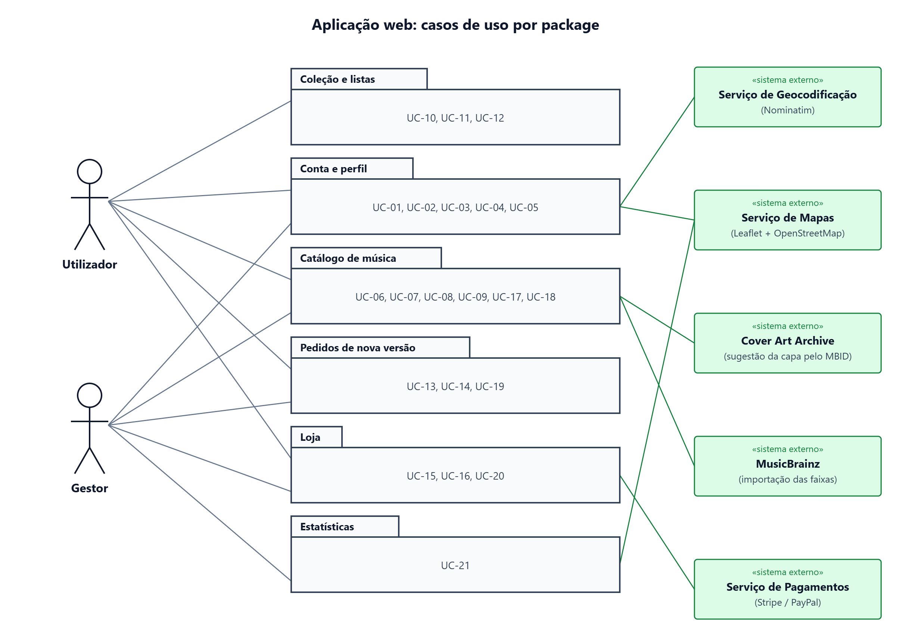

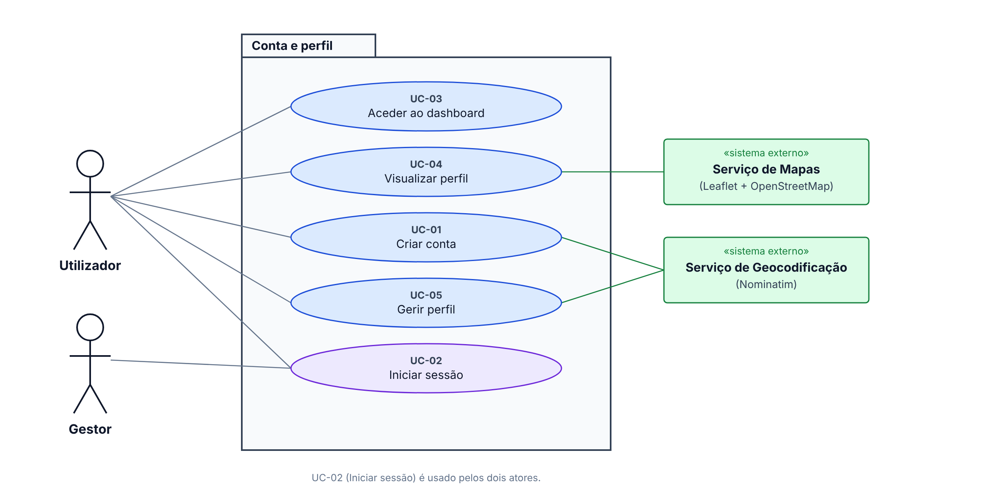

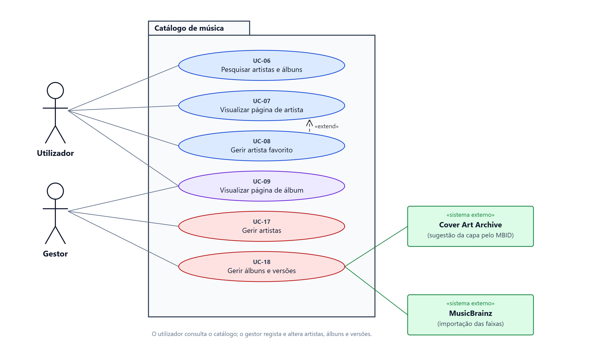

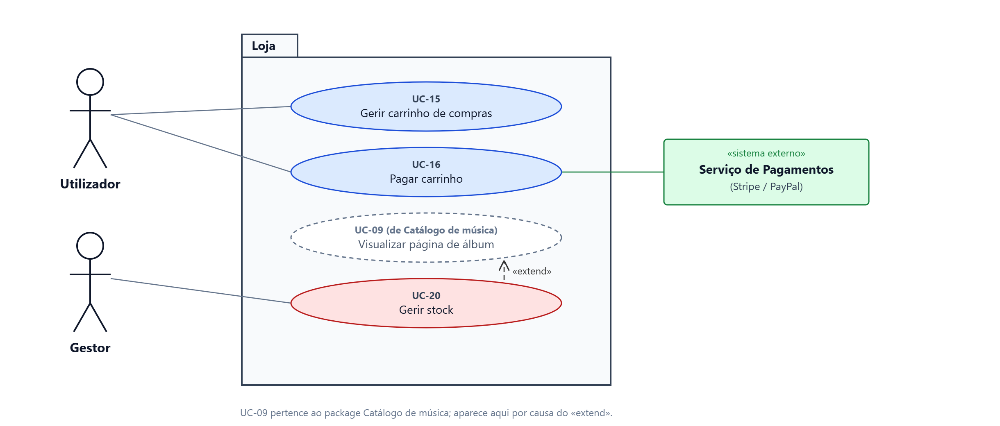

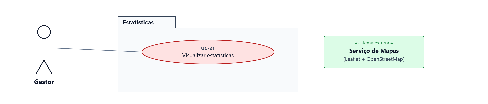

## Lista de casos de uso

**Tabela 7 — Casos de uso e user stories correspondentes**

| ID | Caso de uso | Package | Atores | User stories |
|---|---|---|---|---|
| UC-01 | Criar conta | Conta e perfil | Utilizador, Serviço de Geocodificação | US1 |
| UC-02 | Iniciar sessão | Conta e perfil | Utilizador, Gestor | US2 |
| UC-03 | Aceder ao dashboard | Conta e perfil | Utilizador | US19 |
| UC-04 | Visualizar perfil | Conta e perfil | Utilizador, Serviço de Mapas | US3 |
| UC-05 | Gerir perfil | Conta e perfil | Utilizador, Serviço de Geocodificação | US4 |
| UC-06 | Pesquisar artistas e álbuns | Catálogo de música | Utilizador | US5, US8 |
| UC-07 | Visualizar página de artista | Catálogo de música | Utilizador | US6 |
| UC-08 | Gerir artista favorito | Catálogo de música | Utilizador | US7 |
| UC-09 | Visualizar página de álbum | Catálogo de música | Utilizador, Gestor | US9 |
| UC-10 | Gerir coleção | Coleção e listas | Utilizador | US10, US11 |
| UC-11 | Gerir listas personalizadas | Coleção e listas | Utilizador | US15, US16 |
| UC-12 | Gerir conteúdo de uma lista | Coleção e listas | Utilizador | US17, US18 |
| UC-13 | Submeter pedido de nova versão | Pedidos de nova versão | Utilizador | US12 |
| UC-14 | Consultar pedidos e notificações | Pedidos de nova versão | Utilizador | US13, US14 |
| UC-15 | Gerir carrinho de compras | Loja | Utilizador | US26, US27 |
| UC-16 | Pagar carrinho | Loja | Utilizador, Serviço de Pagamentos | US28 |
| UC-17 | Gerir artistas | Catálogo de música | Gestor | US20, US21 |
| UC-18 | Gerir álbuns e versões | Catálogo de música | Gestor, Cover Art Archive, Cloudinary, MusicBrainz | US22, US23 |
| UC-19 | Responder a pedido de nova versão | Pedidos de nova versão | Gestor | US24 |
| UC-20 | Gerir stock («extend» UC-09) | Loja | Gestor | US25 |
| UC-21 | Visualizar estatísticas | Estatísticas | Gestor, Serviço de Mapas | US29 |

As 29 user stories do enunciado estão todas associadas a um caso de uso, e cada uma a um só. A US25 pertence ao UC-20, que é chamado a partir da página do álbum (UC-09) pela relação «extend».

## Cenários dos casos de uso

Como os casos de uso não estão todos no mesmo nível de abstração, o número de cenários é uma medida de tamanho mais justa do que o número de casos de uso. A Tabela 8 lista o cenário principal e os cenários alternativos de cada caso de uso, derivados dos critérios de aceitação das user stories.

**Tabela 8 — Cenários dos casos de uso**

| Caso de uso | Cenário principal | Cenários alternativos | N.º de cenários |
|---|---|---|---|
| UC-01 | Conta criada com coordenadas da morada | Dados inválidos: erro com o motivo (US1 g); Morada não encontrada: conta guardada sem coordenadas | 3 |
| UC-02 | Sessão iniciada: mostra o dashboard | Credenciais erradas: erro genérico (US2 b) | 2 |
| UC-03 | Acesso às funcionalidades a partir do dashboard | Há notificações por ler: contador no sino | 2 |
| UC-04 | Perfil com mapa da morada | Morada sem coordenadas: perfil sem mapa; Sem artista favorito | 3 |
| UC-05 | Alterações guardadas | Palavra-passe atual errada (US4 b); Dados inválidos: erro com o motivo | 3 |
| UC-06 | Sugestões e resultados de artistas ou de álbuns | Sem resultados: mensagem (US5 c, US8 c) | 2 |
| UC-07 | Página do artista com os álbuns mais recentes | Lista completa de álbuns, ordenada por ano (US6 b, c) | 2 |
| UC-08 | Artista adicionado como favorito | Já tem outro favorito: erro (US7 c); Deixar de ter o artista como favorito (US7 d) | 3 |
| UC-09 | Página do álbum com faixas, versões e disponibilidade | Álbum nunca esteve na loja: mensagem discreta (US9 e); Versão esgotada: data da última venda (US9 d) | 3 |
| UC-10 | Versão adicionada à coleção | Versão já está na coleção: erro (US10 c); Ver e ordenar a coleção (US11 c); Remover um álbum (US11 f) | 4 |
| UC-11 | Lista criada | Nome repetido ou com mais de 100 carateres: erro; Ainda não há listas: mensagem (US16 d); Ordenar as listas (US16 b); Remover uma lista (US16 e) | 5 |
| UC-12 | Álbum adicionado a uma lista | Álbum já está na lista: erro (US17 c); Lista vazia: mensagem (US18 d); Ordenar o conteúdo (US18 b); Remover um álbum (US18 e) | 5 |
| UC-13 | Pedido guardado com estado "em análise" | Dados inválidos: erro com o motivo | 2 |
| UC-14 | Lista dos pedidos do utilizador | Filtrar por estado (US13 e); Abrir a notificação de um pedido aceite ou recusado (US14) | 3 |
| UC-15 | Versão colocada no carrinho | Versão sem unidades: botão inativo (US26 a); Ver o carrinho (US27); Remover um álbum (US27 d) | 4 |
| UC-16 | Pagamento com sucesso: fatura, coleção e stock | Uma versão esgotou entretanto: sai do carrinho; Pagamento recusado e nova tentativa com outro serviço (US28 g); Sem resposta no tempo limite: reserva libertada; Cancelamento pelo utilizador (US28 g) | 5 |
| UC-17 | Artista registado | Dados inválidos: erro com o motivo (US20 b, c); Alterar os dados de um artista (US21) | 3 |
| UC-18 | Álbum novo registado com a primeira versão | Nova versão de um álbum existente (US22 b); Dados inválidos: erro com o motivo (US22 i); Alterar os dados do álbum e das versões (US23); Capa sugerida pelo Cover Art Archive; Faixas importadas do MusicBrainz | 6 |
| UC-19 | Pedido aceite: versão criada e utilizador notificado | Pedido recusado: utilizador notificado (US24 d) | 2 |
| UC-20 | Unidades de uma versão alteradas | Primeira vez à venda: pede o preço e regista a data (US25 b) | 2 |
| UC-21 | Estatísticas com as três tabelas e o mapa | Abrir a página de um utilizador ou álbum das estatísticas (US29 e) | 2 |
| **Total** | 21 | 45 | **66** |

Esta lista vai servir de base à estimação de esforço na Etapa 2, tanto pelo método dos Use Case Points como pela decomposição por funcionalidade.

# Modelo de dados

O modelo de dados define a informação que a aplicação web tem de guardar de forma persistente: as classes, os seus atributos, as associações entre elas e as restrições de integridade. Foi construído a partir do universo do discurso do enunciado, das restrições de integridade RI-01 a RI-30 e dos dados que as user stories precisam de mostrar ou alterar.

Como o modelo completo não cabe numa página A4, foi dividido em cinco agrupamentos lógicos. A Figura 8 mostra a visão geral, só com classes e associações e os agrupamentos identificados por cores. As Figuras 9 a 13 mostram cada agrupamento com os atributos e as restrições de integridade.

## Visão geral

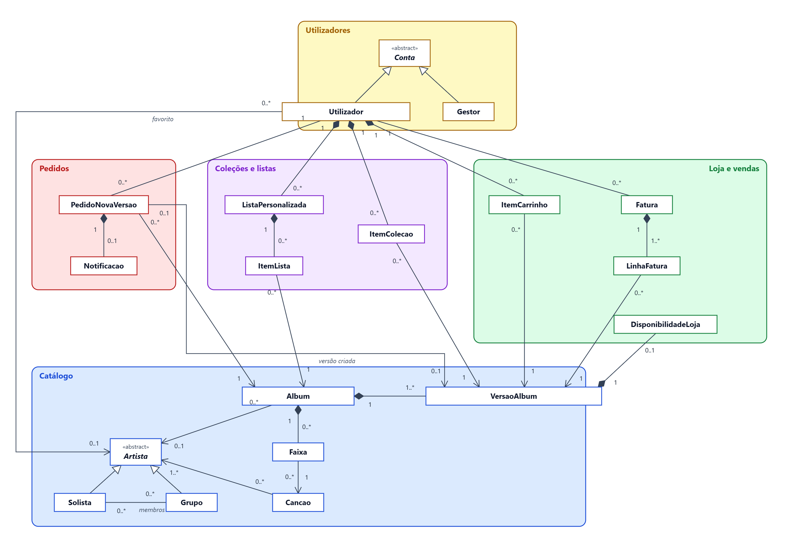

**Tabela 9 — Agrupamentos do modelo de dados**

| Cor | Agrupamento | Classes |
|---|---|---|
| Azul | Catálogo | Artista, Solista, Grupo, Album, Cancao, Faixa, VersaoAlbum |
| Verde | Loja e vendas | DisponibilidadeLoja, ItemCarrinho, Fatura, LinhaFatura |
| Amarelo | Utilizadores | Conta, Utilizador, Gestor |
| Roxo | Coleções e listas | ItemColecao, ListaPersonalizada, ItemLista |
| Vermelho | Pedidos | PedidoNovaVersao, Notificacao |

A classe central do modelo é a **VersaoAlbum**: a versão concreta de um álbum num suporte físico, identificada pelo código EAN-13. É ela que o utilizador compra, coloca no carrinho e adiciona à coleção, e é a ela que se associam o stock e o preço na loja.

## Catálogo

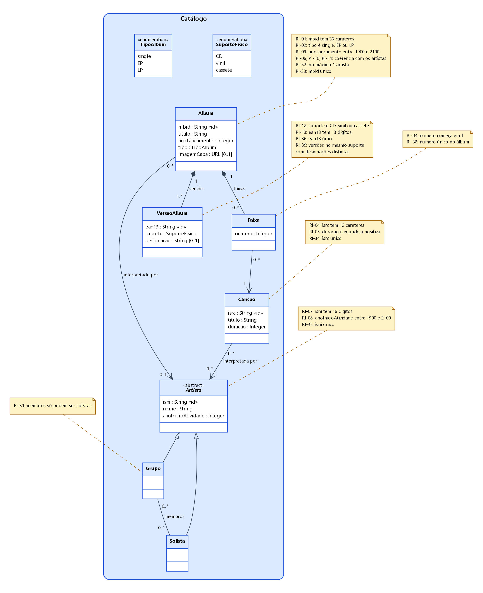

- **Artista** é uma classe abstrata com duas especializações, **Solista** e **Grupo**. Os membros de um grupo são representados pela associação `membros` entre Grupo e Solista; como esta associação só liga grupos a solistas, o próprio modelo garante que um grupo não pode ter outros grupos como membros, nem a si próprio.
- **Album** é interpretado por no máximo um artista. Os álbuns de compilação não têm artista associado e a aplicação mostra um texto por omissão, como "Vários artistas".
- **Cancao** é interpretada por um ou mais artistas e pode aparecer em vários álbuns. Por isso, a posição de uma canção num álbum é representada pela classe **Faixa**, que tem o número de ordem e liga um álbum a uma canção.
- **VersaoAlbum** representa o álbum num suporte físico (CD, vinil ou cassete) e numa versão com designação própria, por exemplo a cor do vinil. Cada álbum tem uma ou mais versões.

## Loja e vendas

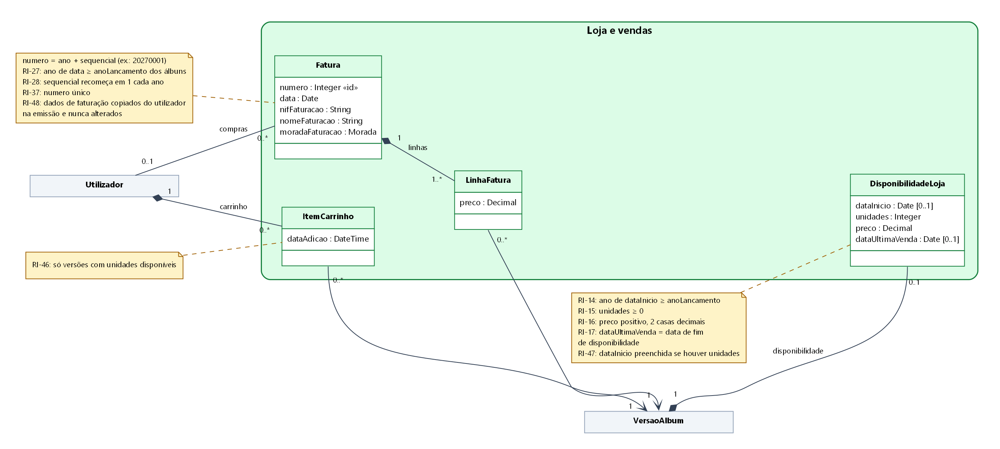

- **DisponibilidadeLoja** guarda, para cada versão que tem preço na loja, a data em que ficou disponível, o número de unidades, o preço e, quando esgota, a data da última venda. A data de início é opcional (0..1): uma versão pode ser registada com preço e 0 unidades (US22 a), e a data só é preenchida quando passa a ter unidades (US22 g, RI-47). Esta data da última venda é a "data de fim de disponibilidade" referida na RI-17: só é preenchida quando a versão esgota. Por ser opcional, distingue as três situações mostradas na página do álbum (US9): nunca esteve na loja, está disponível ou esgotou.
- **ItemCarrinho** representa uma versão colocada no carrinho, com a data de adição, para mostrar os itens mais recentes primeiro (US27).
- **Fatura** é emitida quando o pagamento no serviço externo tem sucesso (US28). O número tem o ano seguido de um sequencial que recomeça em cada ano (por exemplo, 20270001). Cada fatura tem uma ou mais **LinhaFatura**, que guardam o preço pago por cada versão, porque o preço na loja pode mudar depois da compra.
- A fatura guarda também uma **cópia dos dados de faturação** do utilizador (NIF, nome e morada), que a US28 d) exige na fatura. Estes dados ficam fixos no momento da emissão (RI-48): não mudam se o utilizador alterar o perfil, e a fatura mantém-se se o utilizador apagar a conta (RNF-16). Por isso, do lado da fatura, a ligação ao utilizador é opcional (0..1).

## Utilizadores

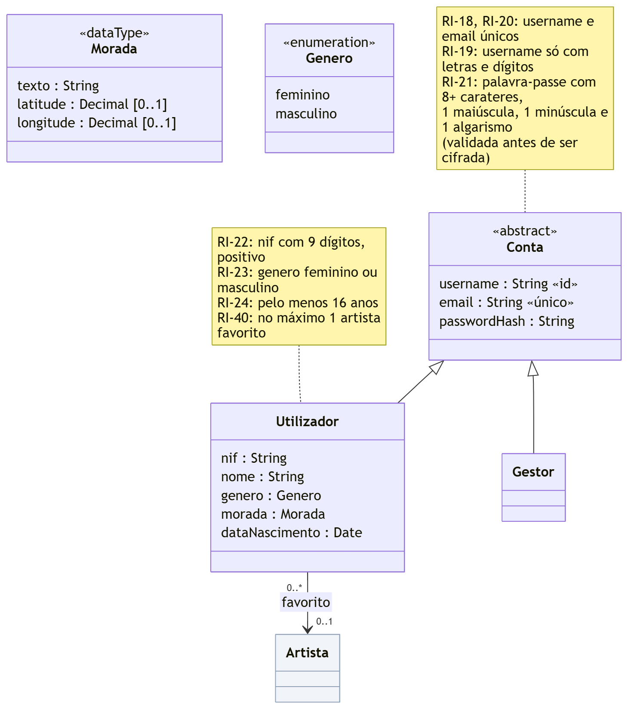

- **Conta** é uma classe abstrata com os dados de acesso comuns: username, e-mail e palavra-passe. A palavra-passe é guardada cifrada, como recomenda a RNF-12.
- **Utilizador** acrescenta os dados pessoais: NIF, nome, género, morada e data de nascimento. A **Morada** é um tipo de dados com o texto e as coordenadas geográficas, opcionais porque só existem quando o serviço de geocodificação consegue converter a morada (US3).
- **Gestor** representa a conta do gestor da loja, que já existe pré-configurada.
- Cada utilizador pode ter no máximo um artista favorito (US7).

## Coleções e listas

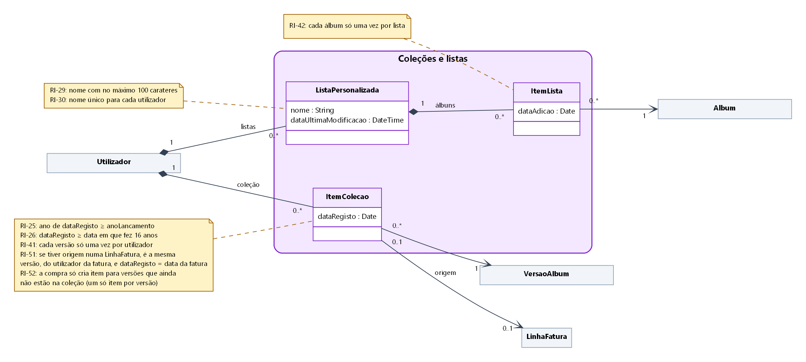

- **ItemColecao** regista uma versão que o utilizador tem, com a data de registo. Os itens são criados por adição manual (US10) ou automaticamente depois de uma compra (US28). Neste último caso, o item fica ligado à **LinhaFatura** de origem (associação opcional `origem`), o que permite distinguir os álbuns comprados na loja dos adicionados à mão, por exemplo nas estatísticas (US29). Como cada versão só pode estar uma vez na coleção (RI-41), a compra só cria itens para as versões que o utilizador ainda não tem, e uma versão comprada em várias unidades dá um só item (RI-52).
- **ListaPersonalizada** tem um nome e a data da última modificação. Cada **ItemLista** liga a lista a um **álbum**, e não a uma versão, com a data de adição, porque as listas organizam álbuns independentemente das versões (US15, US17).

## Pedidos

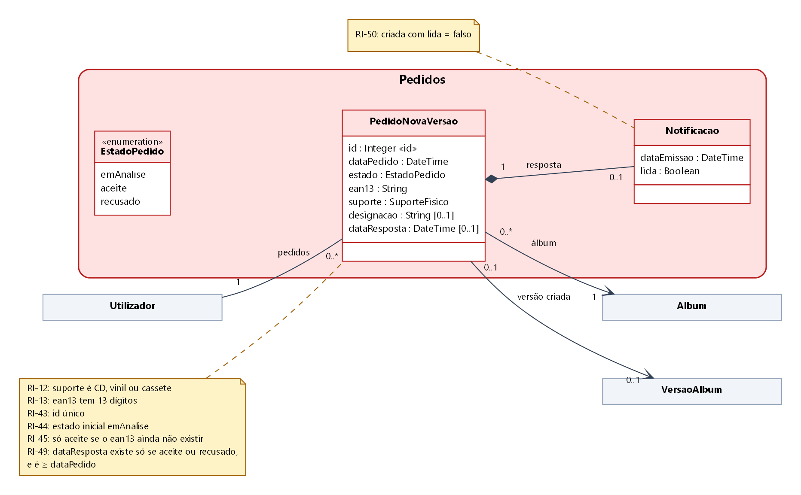

- **PedidoNovaVersao** guarda o pedido de um utilizador para acrescentar uma versão a um álbum existente: identificador, data, estado, data de resposta e dados da versão pedida (EAN-13, suporte físico e designação). A data de resposta só é preenchida quando o gestor aceita ou recusa o pedido (RI-49).
- O estado é "em análise" quando o pedido é criado e passa a "aceite" ou "recusado" quando o gestor responde (US24). Quando o pedido é aceite, é criada uma nova VersaoAlbum, que fica associada ao pedido.
- **Notificacao** é criada quando o pedido é respondido (US14). Está ligada ao pedido, de onde se obtêm o destinatário e a resposta. O atributo `lida` permite mostrar no sino do dashboard o número de notificações por ler; uma notificação nova começa como não lida (RI-50).

## Principais decisões de modelação

**Tabela 10 — Decisões de modelação**

| Decisão | Justificação |
|---|---|
| Solista e Grupo como subclasses de Artista | O modelo impede, por construção, que um grupo tenha grupos como membros. |
| Faixa como classe própria | A mesma canção pode estar em vários álbuns, com números de faixa diferentes. |
| Álbum com no máximo um artista | Os álbuns de compilação não têm artista (nota 10 do enunciado). |
| Álbum pode não ter faixas | O registo de álbuns (US22) não inclui as canções, que podem ser importadas mais tarde. |
| VersaoAlbum separada de Album | O que se compra, coleciona e põe no carrinho é uma versão concreta, identificada pelo EAN-13. |
| DisponibilidadeLoja separada e opcional | Distingue "nunca esteve na loja", "disponível" e "esgotado" (US9). |
| Preço guardado na LinhaFatura | A fatura mantém o preço pago, mesmo que o preço na loja mude. |
| A coleção guarda versões e as listas guardam álbuns | Segue a US10 e as US15 e US17. |
| Conta como superclasse de Utilizador e Gestor | Ambos iniciam sessão; só o utilizador tem dados pessoais, coleção e compras. |
| Palavra-passe cifrada | RNF-12; no perfil (US3) a palavra-passe é mostrada mascarada. |
| Notificação ligada ao pedido | Evita repetir o destinatário e a resposta, que já estão no pedido. |
| Cópia dos dados de faturação na Fatura | A US28 d) exige os dados do utilizador na fatura, e estes não podem mudar se o perfil for alterado ou a conta apagada (RNF-16). |
| Utilizador 0..1 do lado da Fatura | Permite apagar a conta mantendo as faturas, que têm de ser conservadas. |
| Notificacao com o atributo `lida` | Necessário para o contador de notificações por ler no dashboard (US14 a). |
| PedidoNovaVersao com `dataResposta` | Regista quando o gestor respondeu ao pedido (US24). |
| ItemColecao ligado à LinhaFatura de origem | Distingue os itens comprados na loja dos adicionados à mão (útil na US29). |
| A compra não repete versões na coleção | A US28 d) adiciona as compras à coleção, mas a RI-41 não deixa a mesma versão aparecer duas vezes: só se criam itens para versões novas (RI-52). |
| dataInicio opcional | Uma versão pode ter preço sem nunca ter tido unidades (US22 a, US25 b). |
| `dataUltimaVenda` como data de fim de disponibilidade | É a data referida na RI-17; só existe quando a versão esgota. |

## Restrições de integridade

As restrições RI-01 a RI-30 do enunciado estão representadas nas notas das classes a que se aplicam (Figuras 9 a 13). As que envolvem várias classes são:

- **RI-06:** se um álbum é interpretado por um artista, esse artista interpreta todas as canções das faixas do álbum.
- **RI-10 e RI-11:** o ano de lançamento de um álbum é igual ou posterior ao ano de início de atividade do artista que o interpreta e de todos os artistas das canções das suas faixas.
- **RI-14, RI-25 e RI-27:** as datas de disponibilidade, de adição à coleção e das faturas não podem ser anteriores ao ano de lançamento do álbum.

Foram ainda identificadas 22 restrições novas, a partir do universo do discurso, das notas de rodapé e dos critérios de aceitação das user stories. O Anexo A associa todas as restrições às classes do modelo.

**Tabela 11 — Restrições de integridade novas**

| ID | Restrição | Origem |
|---|---|---|
| RI-31 | Os membros de um grupo só podem ser artistas solistas: um grupo não pode ter como membros outros grupos, nem a si próprio. | Universo do discurso |
| RI-32 | Um álbum é interpretado por, no máximo, um artista. | Universo do discurso, nota 10 |
| RI-33 | O código MBID identifica univocamente um álbum. | Universo do discurso |
| RI-34 | O código ISRC identifica univocamente uma canção. | Universo do discurso |
| RI-35 | O código ISNI identifica univocamente um artista. | Universo do discurso |
| RI-36 | O código EAN-13 identifica univocamente uma versão de um álbum. | Universo do discurso |
| RI-37 | O número de uma fatura identifica univocamente a fatura. | Nota 7 |
| RI-38 | O número de faixa é único dentro de cada álbum. | Universo do discurso |
| RI-39 | Se um álbum tiver mais do que uma versão no mesmo suporte físico, todas têm designação, e as designações são diferentes. | Universo do discurso, US9 c) |
| RI-40 | Um utilizador tem, no máximo, um artista favorito. | US7 c) |
| RI-41 | Uma versão só pode constar uma vez na coleção de um utilizador. | US10 c) |
| RI-42 | Um álbum só pode constar uma vez em cada lista personalizada. | US17 c) |
| RI-43 | O identificador de um pedido de nova versão é único. | US13 c) |
| RI-44 | O estado de um pedido só pode ser "em análise", "aceite" ou "recusado", e o estado inicial é "em análise". | US12 d), US13 d), US24 b) |
| RI-45 | Um pedido só pode ser aceite se o EAN-13 pedido não corresponder a uma versão já existente. | US24 c) |
| RI-46 | Só pode ser colocada no carrinho uma versão disponível na loja (com unidades maiores que zero). | US26 a) |
| RI-47 | Quando uma versão é registada com unidades maiores que zero, a data de início de disponibilidade tem de estar preenchida. | US22 g), US25 b) |
| RI-48 | Os dados de faturação (NIF, nome e morada) são copiados do utilizador na emissão da fatura e não são alterados depois. | US28 d), RNF-16 |
| RI-49 | A data de resposta de um pedido existe se e só se o estado for "aceite" ou "recusado", e é igual ou posterior à data do pedido. | US24 c) e d) |
| RI-50 | Uma notificação é criada como não lida. | US14 a) |
| RI-51 | Um item da coleção com origem numa linha de fatura refere-se à mesma versão, pertence ao utilizador da fatura e tem como data de registo a data da fatura. | US28 d) |
| RI-52 | Ao pagar o carrinho, só é criado um item na coleção para cada versão comprada que ainda não esteja na coleção do utilizador; várias unidades da mesma versão dão um só item. | US28 d), RI-41 |

# Fluxos de trabalho

Os diagramas de atividades mostram os passos dos fluxos de trabalho que a aplicação web tem de suportar e quem executa cada passo. Seguem a notação UML: cada diagrama começa num nó inicial (círculo preto) e termina num nó final (anel com ponto); as decisões e os pontos onde os fluxos se juntam (merge) são losangos vazios, com as condições nas guardas `[ ]` das setas; as barras pretas são fork e join, e marcam ações que correm em paralelo; o símbolo ⋔ (ancinho) marca uma ação de chamada (call behavior action), decomposta num diagrama de subatividade. Cada diagrama está dividido em raias (swimlanes), uma por ator: o utilizador, o gestor da loja, a aplicação web e os serviços externos.

Foram escolhidos os fluxos que envolvem vários atores ou várias user stories, porque são os mais difíceis de implementar. O fluxo de compra, o mais complexo, foi representado num diagrama de alto nível, com o pagamento decomposto num diagrama de subatividade.

Não há um diagrama por user story nem um só diagrama para toda a aplicação: cada diagrama representa um **fluxo de trabalho completo**, do início ao fim, que pode juntar várias user stories (como o exemplo da compra numa loja, no enunciado). Os fluxos encadeiam-se **sem quebras**:

- "Criar conta e iniciar sessão" (Figura 17) termina no dashboard, que é o ponto de partida dos fluxos do utilizador: "Comprar álbuns" (Figura 14) e "Pedido de nova versão de um álbum" (Figura 16).
- "Pagar o carrinho" (Figura 15) é a decomposição da ação "Pagar o carrinho ⋔" do fluxo de compra; termina com a fatura emitida, as versões na coleção e o stock atualizado, ou com o pagamento cancelado.
- "Gerir o catálogo" (Figura 18) termina com a versão registada e com unidades à venda, que é o que torna possível a compra; e "Pedido de nova versão" junta o utilizador e o gestor no mesmo fluxo, até a nova versão poder ser adicionada à coleção.

**Tabela 12 — Diagramas de atividades**

| Figura | Fluxo | User stories |
|---|---|---|
| 14 | Comprar álbuns (alto nível) | US8, US9, US26, US27, US28 |
| 15 | Pagar o carrinho (subatividade) | US28 |
| 16 | Pedido de nova versão de um álbum | US9, US10, US12, US13, US14, US24 |
| 17 | Criar conta e iniciar sessão | US1, US2, US19 |
| 18 | Gerir o catálogo | US20, US22, US25 |

## Comprar álbuns

O utilizador pesquisa um álbum, abre a sua página, escolhe uma versão e, se estiver disponível na loja, coloca-a no carrinho. Pode repetir estes passos para vários álbuns e remover itens antes de pagar. Se, ao pagar, alguma versão tiver esgotado entretanto, o utilizador volta ao carrinho já atualizado.

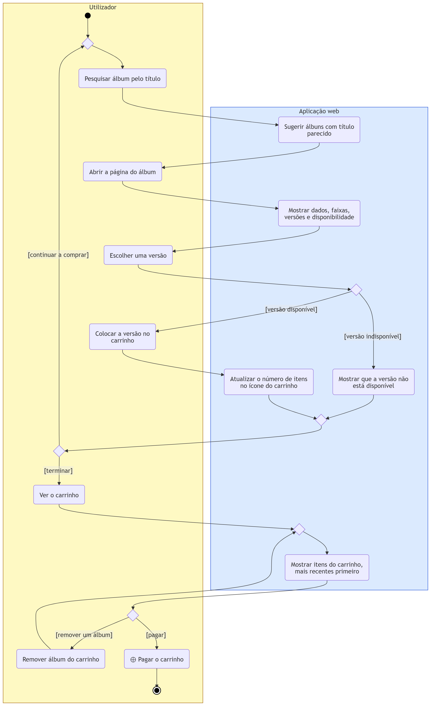

O pagamento (Figura 15) envolve o serviço externo escolhido pelo utilizador, Stripe ou PayPal:

1. Antes de pagar, a aplicação verifica e **reserva as unidades** das versões do carrinho. Se entretanto outro utilizador tiver comprado a última unidade de alguma versão, as unidades já reservadas são libertadas, essa versão é retirada do carrinho e o utilizador é avisado e volta ao carrinho.
2. O utilizador escolhe o serviço; a aplicação calcula o total e inicia o pagamento. O utilizador introduz os dados de pagamento na página do serviço, pelo que a aplicação nunca trata os dados do cartão.
3. A aplicação espera pelo resultado enviado pelo serviço (US28 c). Se o pagamento for recusado ou não houver resposta dentro do **tempo limite**, a reserva é libertada e o utilizador pode tentar com outro serviço ou cancelar o pagamento (US28 g); cancelar é uma ação do utilizador.
4. Se o pagamento tiver sucesso, a aplicação emite a fatura com os dados de faturação e, **em paralelo** (fork/join), adiciona à coleção do utilizador as versões que ainda não estão lá, ligadas às linhas da fatura (RI-41, RI-52), e confirma a saída das unidades reservadas. Se tiver sido vendida a última unidade de uma versão, atualiza a data de fim de disponibilidade, que é a data da última venda (US28 f, RI-17). No fim, esvazia o carrinho e mostra um resumo.

A fatura é emitida antes do fork porque os itens da coleção ficam ligados às linhas da fatura (RI-51); as duas ações seguintes são independentes.

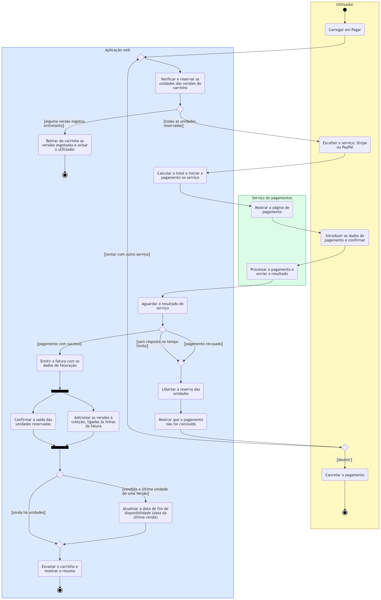

## Pedido de nova versão de um álbum

Este fluxo junta quatro user stories e três atores:

1. O utilizador escolhe um álbum e preenche os dados da nova versão. A aplicação valida o EAN-13 e o suporte físico e guarda o pedido com o estado "em análise" (US12).
2. O gestor abre o pedido e decide. Se a versão for nova e interessante para a loja, a aplicação cria a versão no álbum e muda o estado para "aceite"; caso contrário, muda-o para "recusado" (US24). Em ambos os casos regista a data de resposta (RI-49).
3. Em ambos os casos é criada uma notificação, por ler, que o utilizador vê no dashboard (US14).
4. Se o pedido foi aceite, a nova versão aparece na página do álbum e o utilizador pode adicioná-la à coleção (US9, US10).

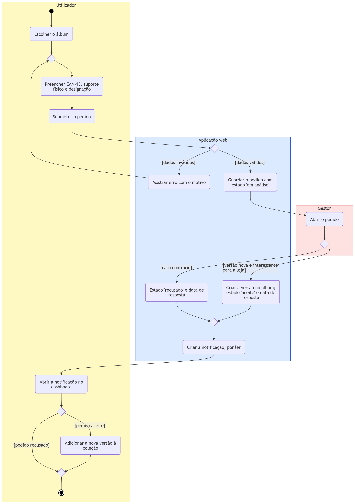

## Criar conta e iniciar sessão

Na criação de conta, a aplicação mostra os requisitos do username e da palavra-passe e valida os dados (RI-18 a RI-24). Se forem válidos, cifrar a palavra-passe e pedir as coordenadas da morada ao serviço de geocodificação são feitos em paralelo (fork/join), porque não dependem um do outro. Se a morada for encontrada, a conta é guardada com as coordenadas; caso contrário, é guardada sem elas, e o perfil não mostra o mapa (US3).

No início de sessão, se as credenciais estiverem erradas, a mensagem de erro é genérica e não revela se o username existe (US2 b). Se estiverem certas, a aplicação mostra o dashboard.

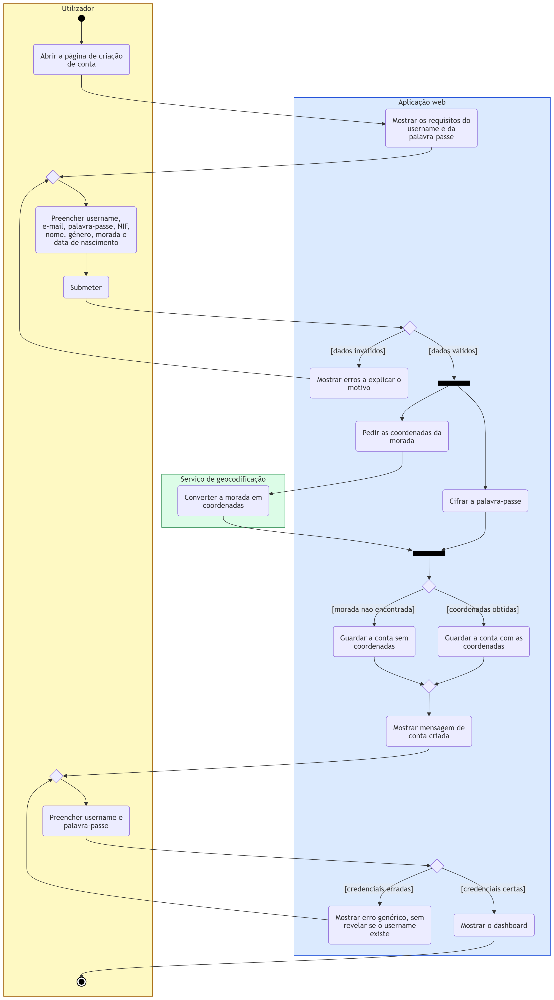

## Gerir o catálogo

O gestor regista o artista, se ainda não existir (US20); um álbum de compilação não tem artista e segue diretamente para o registo do álbum (US22 e). Depois regista um álbum novo, com a primeira versão, ou acrescenta uma versão a um álbum existente (US22). Se a versão for registada com unidades, a aplicação preenche automaticamente a data de início de disponibilidade (US22 g).

Mais tarde, na página do álbum, o gestor pode alterar as unidades de uma versão. Se for a primeira vez que essa versão é posta à venda, a aplicação pede o preço e regista a data de disponibilidade (US25 b).

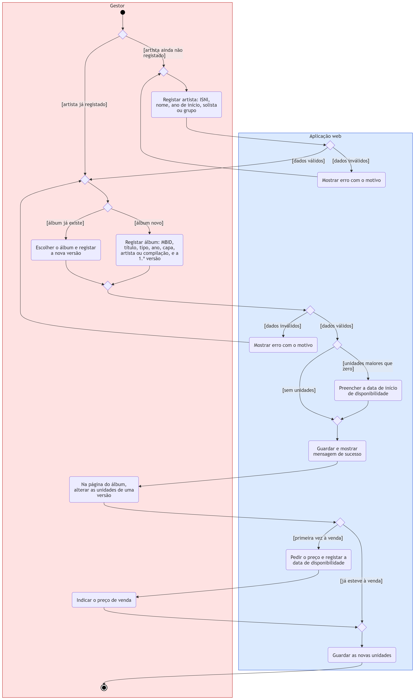

# Esboços da interface

Os esboços mostram como o utilizador e o gestor interagem com a aplicação, e ajudam a perceber a complexidade das user stories antes de as implementar. Como pede o enunciado, o foco está nas funcionalidades mais complexas: as que juntam várias user stories no mesmo ecrã ou envolvem serviços externos.

Os esboços são de baixa fidelidade: mostram a estrutura, os dados e as ações de cada ecrã, mas não o aspeto gráfico final. São desenhados só a preto e branco, sem cores nem ícones, para que a atenção fique no conteúdo de cada ecrã. Cada esboço tem notas numeradas que indicam a user story ou a restrição que justifica cada elemento.

## Página de álbum

É o ecrã mais complexo, porque junta cinco user stories. Mostra os dados do álbum, as faixas e uma tabela de versões. Para cada versão aparece o estado na loja: disponível, esgotada (com a data da última venda) ou "nunca esteve disponível". Os botões "Coleção" e "Carrinho" atuam sobre a versão, e o do carrinho só fica ativo se houver unidades. O gestor vê uma coluna adicional para alterar as unidades. O botão "Adicionar a uma lista" atua sobre o álbum, porque as listas guardam álbuns. Uma versão que já está na coleção mostra "✓ Na coleção", inativo (US10 c). A versão Vinil Azul é a que foi criada ao aceitar o pedido nº 12 do esboço de pedidos (US14 c).

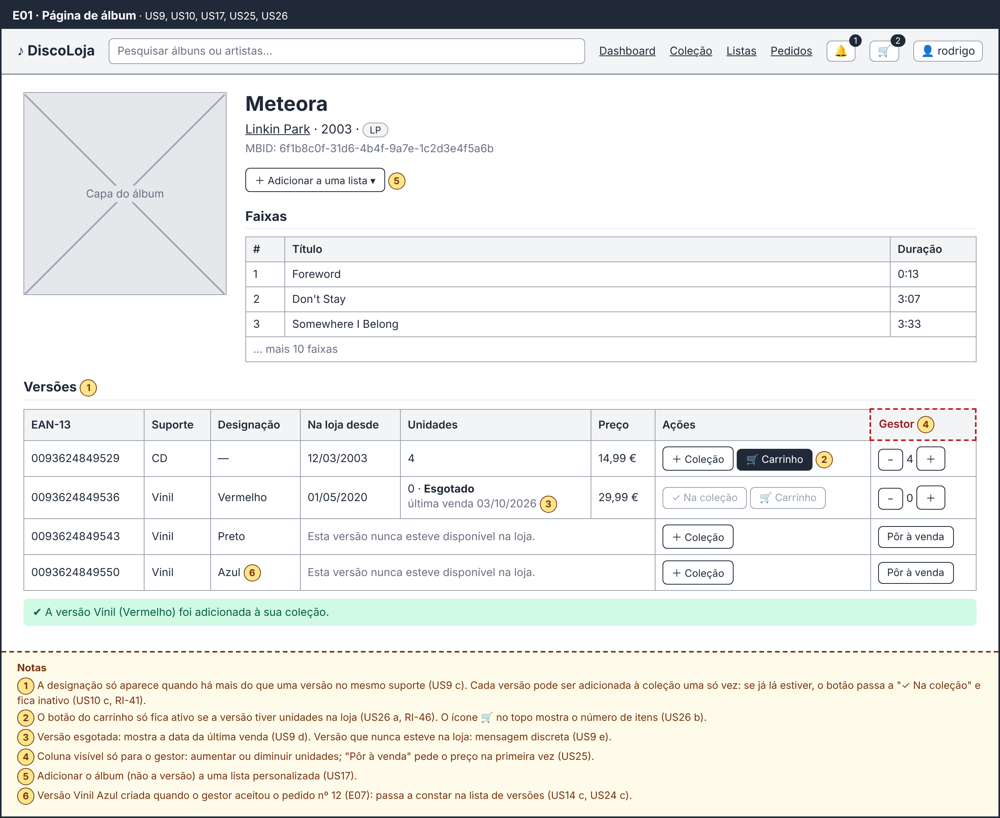

## Carrinho e pagamento

Os álbuns aparecem do mais recente para o mais antigo, com o total no fim. Ao pagar, o utilizador escolhe entre Stripe e PayPal e é redirecionado para a página segura do serviço. O esboço mostra também as mensagens de falha e de sucesso.

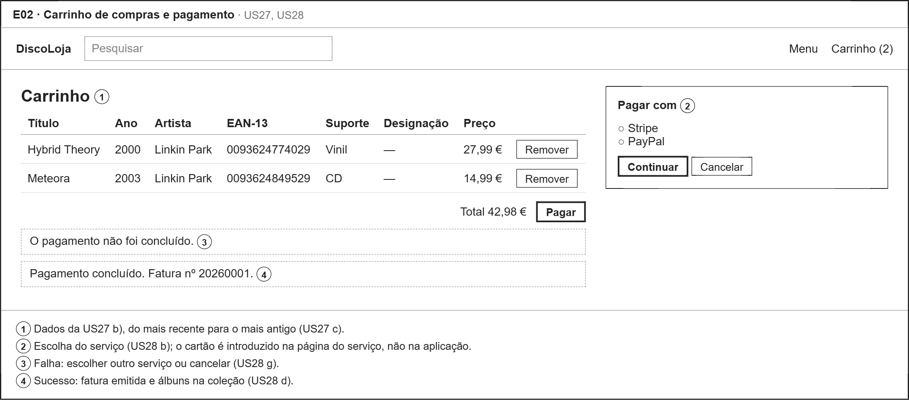

## Conta, perfil e pesquisa

Na criação de conta, os requisitos do username e da palavra-passe estão sempre visíveis e os erros aparecem junto ao campo. O campo da morada não tem sugestões automáticas, por causa da política de utilização do Nominatim. No perfil, a palavra-passe aparece mascarada e o mapa só aparece se a morada tiver coordenadas. Na pesquisa, um único campo serve para álbuns e artistas, com sugestões à medida que se escreve.

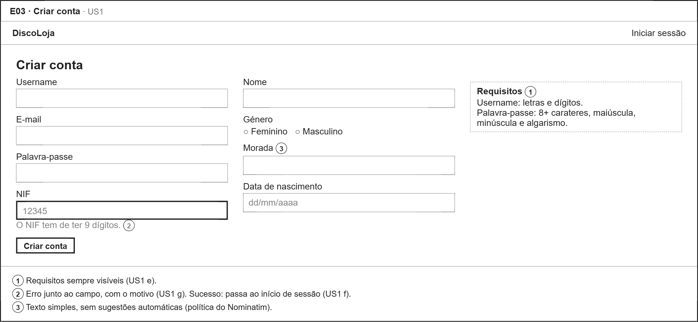

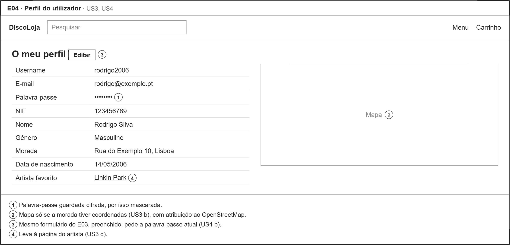

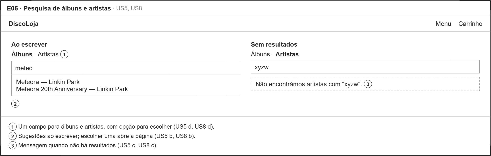

## Coleção, pedidos e dashboard

A coleção é uma tabela que se pode ordenar por qualquer coluna, com ligações para as páginas do álbum e do artista. A página de pedidos tem filtro por estado, um formulário para pedidos novos e o painel de notificações. O dashboard dá acesso à pesquisa, à coleção, às listas, aos pedidos e às notificações (US19 a, US14 a).

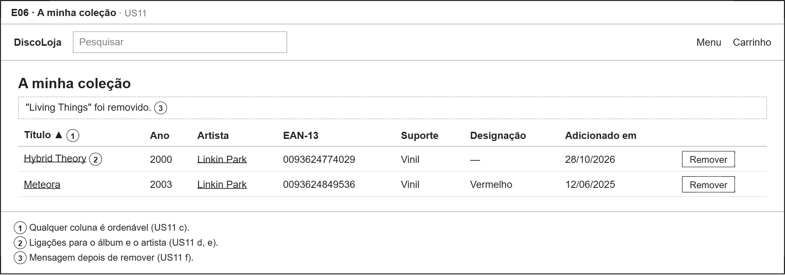

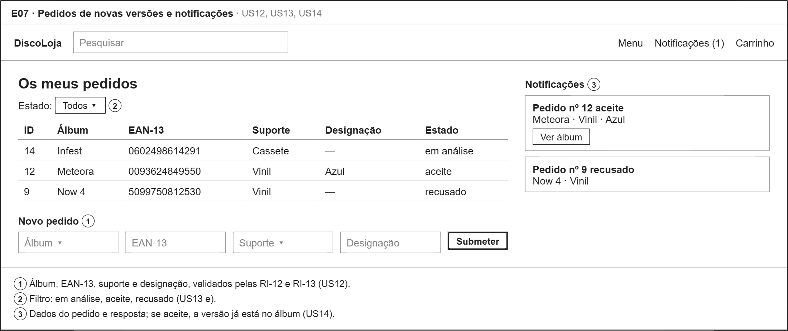

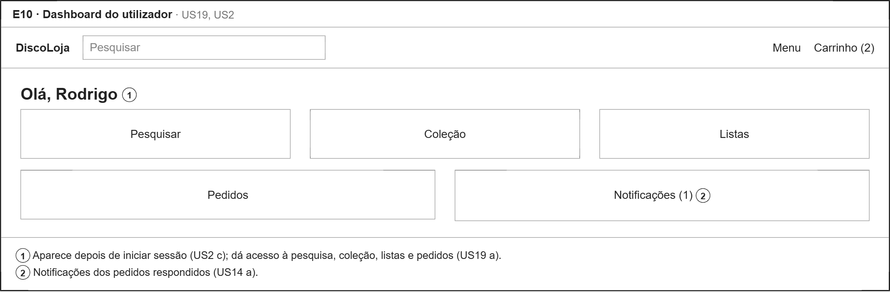

## Ecrãs do gestor

O formulário de registo alterna entre "novo álbum" e "nova versão de um álbum existente", e a data de disponibilidade é preenchida automaticamente quando há unidades. A capa sugerida pelo Cover Art Archive aparece ao lado do campo, para o gestor a confirmar ou carregar outra, e há um botão para importar as faixas do MusicBrainz. As estatísticas mostram as três tabelas pedidas na US29 e um mapa com as moradas dos cinco maiores colecionadores.

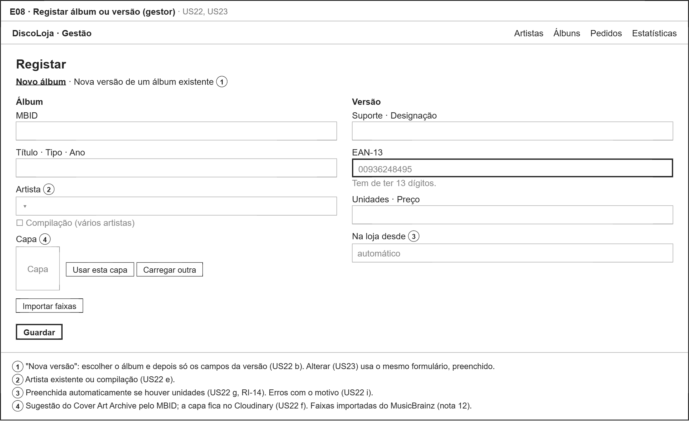

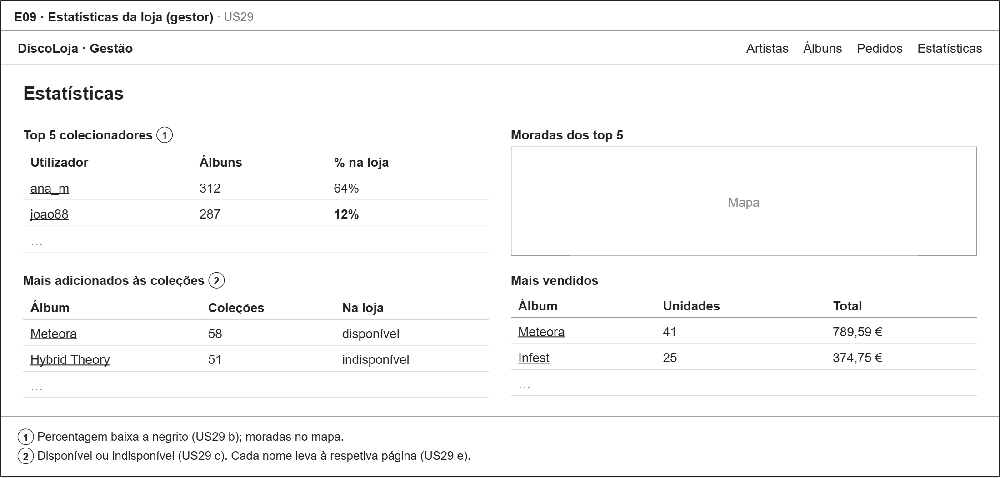

## Adaptação a telemóvel

Para cumprir a RNF-04, os dois ecrãs mais carregados foram também desenhados para telemóvel: as tabelas passam a cartões empilhados, as faixas ficam numa secção que se expande e o total do carrinho fica numa barra fixa no fundo do ecrã.

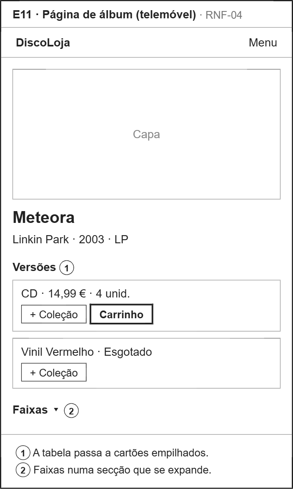

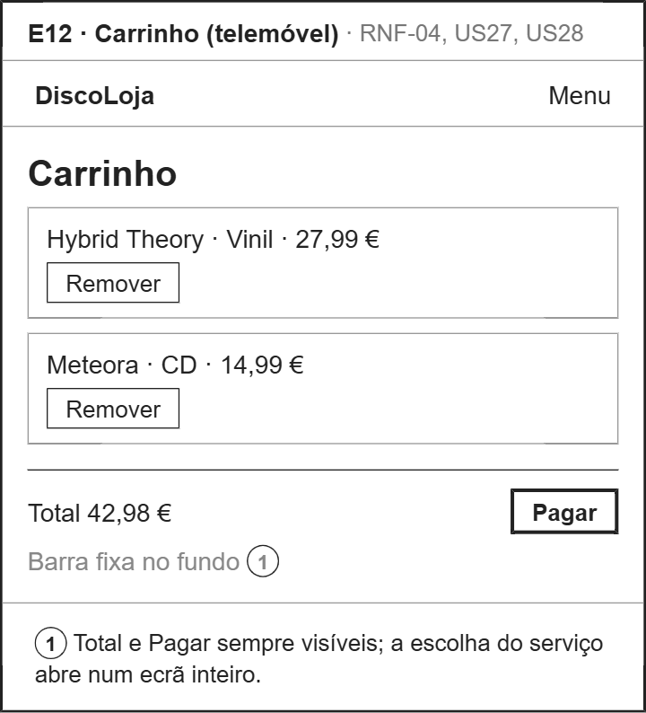

# Pesquisa de serviços externos

A aplicação precisa de serviços externos para mapas, geocodificação, pagamentos, imagens de capa e importação de faixas. Para cada necessidade foram comparadas alternativas, com preços e condições consultados a 27 de outubro de 2026 (mapas, geocodificação e pagamentos) e a 29 de outubro de 2026 (imagens de capa e importação de faixas; o Discogs foi consultado a 5 de novembro de 2026).

**Tabela 13 — Resumo das escolhas**

| Necessidade | User stories | Serviço escolhido | Alternativas comparadas |
|---|---|---|---|
| Mostrar mapas | US3, US29 | Leaflet + OpenStreetMap | Google Maps, Mapbox |
| Converter moradas em coordenadas | US1, US4 (coordenadas usadas na US3 e US29) | Nominatim | Google Geocoding, Mapbox Geocoding |
| Pagamentos online | US28 | Stripe e PayPal | Comparados entre si |
| Imagens de capa | US9 a), US22 f) | Cloudinary, com sugestão do Cover Art Archive | MongoDB (documento ou GridFS) |
| Importar faixas e canções | US9 b), nota 12 | API do MusicBrainz | API do Discogs, introdução manual |

## Mapas

**Tabela 14 — Comparação de serviços de mapas**

| Critério | Leaflet + OpenStreetMap | Google Maps | Mapbox |
|---|---|---|---|
| Custo | Gratuito | 10 000 carregamentos/mês grátis; depois 7 USD por 1000 | Cerca de 50 000 carregamentos/mês grátis; depois cerca de 5 USD por 1000 |
| Conta ou cartão | Não precisa | Conta com faturação ativa | Conta e token |
| Código aberto | Sim (licença BSD) | Não | Não |
| Funcionalidades necessárias | Mapa, marcadores e popups | Todas | Todas |

**Escolha: Leaflet + OpenStreetMap.** É gratuito e não exige conta nem cartão de crédito (RNF-15). É de código aberto, coerente com a RNF-05. As user stories só precisam de mostrar marcadores num mapa, o que o Leaflet faz com pouco código. É também a biblioteca sugerida no enunciado.

## Geocodificação

**Tabela 15 — Comparação de serviços de geocodificação**

| Critério | Nominatim | Google Geocoding | Mapbox Geocoding |
|---|---|---|---|
| Custo | Gratuito | 10 000 pedidos/mês grátis; depois 5 USD por 1000 | 100 000 pedidos/mês grátis, só para resultados temporários |
| Guardar coordenadas na base de dados | Permitido (licença ODbL, com atribuição) | Restrito pelos termos | Pago (modalidade "permanente") |
| Limite | 1 pedido por segundo | Por quota | Por quota |

**Escolha: Nominatim.** O modelo de dados guarda as coordenadas na morada do utilizador, o que o Nominatim permite e os concorrentes restringem ou cobram. A aplicação só geocodifica quando o utilizador cria a conta ou altera a morada, muito abaixo do limite de 1 pedido por segundo.

A política de utilização do Nominatim impõe alguns cuidados, que a equipa vai respeitar:

- um pedido por morada, com o resultado guardado;
- sem pesquisa com preenchimento automático;
- identificação da aplicação e atribuição ao OpenStreetMap;
- envio só da rua, do código postal e da localidade, sem o nome do utilizador.

## Pagamentos

A US28 pede que o utilizador possa escolher o serviço de pagamentos e, se o pagamento falhar, escolher outro. Por isso a aplicação integra dois serviços.

**Tabela 16 — Comparação de serviços de pagamento**

| Critério | Stripe | PayPal |
|---|---|---|
| Taxa por transação (Portugal) | Cartões do EEE: 1,5% + 0,25 € (premium: 2,8% + 0,25 €) | Conta PayPal: 2,9% + 0,35 €; cartões: 1,2% + 0,35 € |
| Mensalidade | Não tem | Não tem |
| Métodos de pagamento | Cartões, MB WAY, Apple Pay, Google Pay | Conta PayPal, cartões |
| Modo de testes | Sim | Sim (sandbox) |
| Integração com Node.js | SDK oficial e página de pagamento alojada | SDK oficial e botões JavaScript |
| Confirmação do resultado | Webhooks | Webhooks |

**Escolha: Stripe como serviço principal e PayPal como alternativa.** O Stripe tem taxas mais baixas para cartões europeus e suporta MB WAY, muito usado em Portugal. A sua página de pagamento alojada evita que a aplicação trate dados de cartão (RNF-12). O PayPal serve quem prefere pagar com a conta PayPal. Os dois avisam o backend do resultado através de webhooks, o que permite cumprir a US28 c). Durante o desenvolvimento só se usam os modos de teste, sem pagamentos reais.

## Imagens de capa

A página de cada álbum mostra a imagem de capa (US9 a), e o gestor associa uma capa ao registar o álbum (US22 f). Foi preciso decidir onde guardar as imagens e de onde podem vir.

**Tabela 17 — Comparação de soluções para as imagens de capa**

| Critério | Cloudinary | MongoDB (documento ou GridFS) | Cover Art Archive (só ligar) |
|---|---|---|---|
| Custo | 25 créditos grátis/mês (1 crédito = 1 GB de armazenamento, 1 GB de tráfego ou 1000 transformações) | Sem custo extra, mas ocupa a base de dados (MongoDB Atlas gratuito: 512 MB) | Gratuito |
| Imagens enviadas pelo gestor | Sim | Sim (até 16 MB num documento; acima disso, GridFS) | Não: só as capas carregadas pela comunidade |
| Miniaturas e telemóvel (RNF-04) | Geradas automaticamente | Feitas pela aplicação | 250, 500 e 1200 px |
| Entrega (RNF-08) | CDN global | Passa pelo backend | Internet Archive |
| Dependência externa | Sim (conta gratuita) | Não | Sim; nem todos os álbuns têm capa |

**Escolha: Cloudinary para guardar as capas, com o Cover Art Archive para as sugerir.** Vantagens:

- O gestor pode carregar qualquer capa (US22 f), mesmo de edições que não estão no Cover Art Archive.
- O plano gratuito chega para o projeto: centenas de capas ocupam menos de 1 GB, enquanto o MongoDB Atlas gratuito tem só 512 MB para todos os dados.
- As miniaturas são geradas automaticamente e a entrega por CDN ajuda o desempenho (RNF-08).
- Ao registar um álbum, a aplicação pede ao Cover Art Archive a capa associada ao MBID e mostra-a como sugestão; o gestor confirma antes de a guardar.

A documentação do Cover Art Archive não define a licença das imagens, cujos direitos pertencem aos titulares. A aplicação usa a capa apenas para identificar o álbum à venda.

## Importação de faixas e canções

Nenhuma user story obrigatória regista as canções, mas a US9 b) mostra as faixas de cada álbum. A nota 12 do enunciado sugere um script ou endpoint para as registar em bloco; é a suposição Q4 da Tabela 19.

**Tabela 18 — Comparação de fontes para importar faixas**

| Critério | API do MusicBrainz | API do Discogs | Introdução manual pelo gestor |
|---|---|---|---|
| Custo | Gratuito | Gratuito (com conta e token) | Gratuito, mas exige trabalho do gestor e user stories extra |
| Dados | Número e título das faixas, duração, artistas e ISRC das gravações | Posição, título e duração das faixas (em texto, ex. "3:07"); sem ISRC por faixa | Os que o gestor escrever |
| Ligação ao modelo | Usa o MBID que o modelo já guarda | Usa identificadores próprios do Discogs: seria preciso procurar o álbum por título | — |
| Licença | Dados centrais (artistas, releases, gravações, faixas, ISRCs) em CC0, sem restrições | Parte dos dados em CC0 e parte com restrições dos termos de utilização | — |
| Limites | Cerca de 1 pedido por segundo por IP; User-Agent com nome da aplicação e contacto; acima do limite, resposta 503 | 60 pedidos por minuto com autenticação, 25 sem | — |

**Escolha: API do MusicBrainz, num endpoint de importação que o gestor aciona ao registar o álbum (botão "Importar faixas" no esboço do registo) e que também pode ser corrido em bloco por um script.** Em relação ao Discogs, o principal concorrente, tem três vantagens: usa o MBID que o modelo já guarda, enquanto o Discogs exigiria procurar cada álbum pelo título; fornece o ISRC, que no nosso modelo identifica a canção; e os dados necessários são todos CC0. Além disso, um álbum inteiro vem num só pedido (`/ws/2/release/{mbid}?inc=recordings+isrcs+artist-credits`), por isso o limite de 1 pedido por segundo não é um problema. Há dois pontos a tratar na implementação: no MusicBrainz as faixas pertencem a um *release* (uma edição concreta), pelo que a importação tem de escolher uma edição do álbum; e nem todas as gravações têm ISRC, que no nosso modelo identifica a canção (RI-34). A duração vem em milissegundos e é convertida em segundos (RI-05).

# Suposições e questões em aberto

Durante o desenho foram encontrados pontos do enunciado ambíguos ou incompletos. Estas questões foram colocadas ao docente e, até haver resposta, a equipa seguiu as suposições indicadas. A versão do enunciado de 4 de novembro de 2026 corrigiu a US28 f) e a US24, e confirmou as suposições Q1 e Q2.

**Tabela 19 — Questões e suposições**

| # | Questão | Suposição adotada |
|---|---|---|
| Q1 | O critério f) da US28 estava incompleto ("Caso tenha sido vendida a última unidade de algum álbum, deve"). | Regista-se a data de fim de disponibilidade dessa versão, igual à data da última venda (RI-17). **Confirmado** na versão de 4/nov do enunciado. |
| Q2 | O estado de um pedido recusado chamava-se "recusado" nas US13 e US14 e "rejeitado" na US24. | Usa-se "recusado". **Confirmado** na versão de 4/nov do enunciado, que corrigiu a US24. |
| Q3 | A US3 pede para mostrar a palavra-passe no perfil, mas a RNF-12 recomenda guardá-la cifrada. | A palavra-passe é guardada cifrada e mostrada mascarada. |
| Q4 | Nenhuma user story obrigatória regista as canções e faixas, mas a US9 mostra-as. | As faixas são importadas da API do MusicBrainz por um endpoint, que o gestor aciona ao registar o álbum ou que um script corre em bloco (nota 12 do enunciado; ver Tabela 18). |
| — | O enunciado não refere quantidades no carrinho nem nas faturas. | Cada linha corresponde a uma unidade de uma versão. |
| — | O registo de membros de grupos é uma funcionalidade extra (nota 11). | O modelo suporta membros, mas são opcionais. |
| — | A US28 d) adiciona os álbuns comprados à coleção, mas a US10 c) e a RI-41 não deixam a mesma versão aparecer duas vezes. | Se o utilizador já tiver a versão, ou comprar várias unidades dela, a coleção fica com um só item dessa versão (RI-52). |

## Decisões da equipa para além do enunciado

Alguns elementos do desenho não são pedidos pelo enunciado: são decisões da equipa para tornar a solução fazível e coerente. Estão aqui reunidos para se distinguirem dos requisitos do cliente e podem ser revistos com ele.

**Tabela 20 — Decisões da equipa que vão além do enunciado**

| Decisão | Onde aparece | Porquê |
|---|---|---|
| Reserva das unidades antes de pagar, com tempo limite | Figura 15, UC-16 | Evita vender a mesma última unidade a dois utilizadores que pagam ao mesmo tempo (RI-15). |
| Notificações com estado "lida" e contador no sino | RI-50, Figura 16, esboços | A US14 a) só pede que a notificação seja acessível a partir da dashboard; o contador ajuda o utilizador a ver que há respostas novas. |
| Cover Art Archive e Cloudinary para as capas | Capítulo 6, UC-18 | A US22 f) pede uma capa, mas não diz de onde vem nem onde se guarda. |
| Importação de faixas do MusicBrainz | Capítulo 6, UC-18 | A US9 b) mostra faixas que nenhuma user story obrigatória regista (nota 12). |
| A compra não repete versões na coleção | RI-52, Figura 15 | Concilia a US28 d) com a US10 c) e a RI-41. |
| Pressupostos quantitativos | Tabela 3 | O enunciado não indica volumes nem tempos de resposta. |

# Anexo A — Restrições de integridade por classe

**Tabela 21 — Associação das restrições às classes do modelo**

| Classe | Atributo ou associação | Restrições |
|---|---|---|
| Artista | isni | RI-07, RI-35 |
| Artista | anoInicioAtividade | RI-08 |
| Grupo | membros | RI-31 |
| Album | mbid | RI-01, RI-33 |
| Album | tipo | RI-02 |
| Album | anoLancamento | RI-09, RI-10, RI-11 |
| Album | associação com Artista | RI-06, RI-32 |
| Faixa | numero | RI-03, RI-38 |
| Cancao | isrc | RI-04, RI-34 |
| Cancao | duracao | RI-05 |
| VersaoAlbum | suporte | RI-12 |
| VersaoAlbum | ean13 | RI-13, RI-36 |
| VersaoAlbum | designacao | RI-39 |
| DisponibilidadeLoja | dataInicio (opcional) | RI-14, RI-47 |
| DisponibilidadeLoja | unidades | RI-15 |
| DisponibilidadeLoja | preco | RI-16 |
| DisponibilidadeLoja | dataUltimaVenda | RI-17 |
| ItemCarrinho | associação com VersaoAlbum | RI-46 |
| Fatura | numero | RI-28, RI-37 |
| Fatura | data | RI-27 |
| Fatura | nifFaturacao, nomeFaturacao, moradaFaturacao | RI-48 |
| LinhaFatura | preco | RI-16 |
| Conta | username | RI-18, RI-19 |
| Conta | email | RI-20 |
| Conta | passwordHash | RI-21 |
| Utilizador | nif | RI-22 |
| Utilizador | genero | RI-23 |
| Utilizador | dataNascimento | RI-24 |
| Utilizador | favorito | RI-40 |
| ItemColecao | dataRegisto | RI-25, RI-26 |
| ItemColecao | associação com VersaoAlbum | RI-41, RI-52 |
| ItemColecao | associação origem com LinhaFatura | RI-51 |
| ListaPersonalizada | nome | RI-29, RI-30 |
| ItemLista | associação com Album | RI-42 |
| PedidoNovaVersao | id | RI-43 |
| PedidoNovaVersao | estado | RI-44, RI-45 |
| PedidoNovaVersao | suporte, ean13 | RI-12, RI-13 |
| PedidoNovaVersao | dataResposta | RI-49 |
| Notificacao | lida | RI-50 |

# Anexo B — Planeamento e estimação da Etapa 1

O trabalho da Etapa 1 foi dividido por artefacto: cada elemento da equipa ficou responsável por um artefacto, com uma revisão cruzada por outro elemento e três reuniões de acompanhamento. O glossário de entidades foi o primeiro entregável, porque todos os artefactos usam os mesmos nomes.

O esforço foi estimado com a **estimativa de três pontos**: para cada tarefa, a equipa indicou um valor otimista (O), um provável (M) e um pessimista (P), e o esforço esperado é E = (O + 4M + P) ÷ 6. O valor provável é o do plano inicial; o otimista e o pessimista são **estimativas da equipa**.

**Tabela 22 — Estimativa de esforço da Etapa 1 (horas)**

| Tarefa | Responsável | Otimista (O) | Provável (M) | Pessimista (P) | Esperada E = (O + 4M + P) ÷ 6 |
|---|---|---|---|---|---|
| Glossário e diagrama de classes | Rodrigo | 9 | 12 | 18 | 12,5 |
| Casos de uso e matriz US↔UC | Reis | 5 | 7,5 | 11 | 7,7 |
| Esboços da interface | Miguel | 8 | 12 | 18 | 12,3 |
| Serviços externos e restrições de integridade | Ze | 8 | 12 | 17 | 12,2 |
| Diagramas de atividades | Edson | 7 | 10 | 15 | 10,3 |
| Relatório (Reis, 4 h) e slides (Edson, 2 h) | Reis, Edson | 4 | 6 | 10 | 6,3 |
| Revisão cruzada (1 h por pessoa) | Todos | 3 | 5 | 8 | 5,2 |
| Reuniões (3 reuniões, cerca de 4 h por pessoa) | Todos | 15 | 20 | 25 | 20 |
| **Total** | | **59** | **84,5** | **122** | **86,5** |

O esforço esperado total é de cerca de **86 h** (84,5 h no valor provável). O desvio-padrão do total, calculado a partir de (P − O) ÷ 6 em cada tarefa, é de cerca de 3,8 h, por isso o esforço deve ficar entre 79 h e 94 h. A divisão continua equilibrada: cada pessoa fica com cerca de 20% do esforço esperado.

# Referências

- Fowler, M. (2005). *UML distilled: A brief guide to the standard object modeling language* (3.ª edição). Addison-Wesley.
- Leaflet. Quick Start Guide. https://leafletjs.com/examples/quick-start
- OpenStreetMap Foundation. Nominatim Usage Policy. https://operations.osmfoundation.org/policies/nominatim/
- Google. Google Maps Platform pricing. https://developers.google.com/maps/billing-and-pricing/pricing-categories
- Mapbox pricing (análise). https://storerocket.io/learn/mapbox-pricing
- Stripe. Preços em Portugal. https://stripe.com/pt/pricing
- Stripe. MB WAY. https://docs.stripe.com/payments/mb-way
- PayPal. Comissões para comerciantes (Portugal). https://www.paypal.com/pt/webapps/mpp/merchant-fees
- MusicBrainz. MusicBrainz Identifier. https://musicbrainz.org/doc/MusicBrainz_Identifier
- Cover Art Archive. API. https://musicbrainz.org/doc/Cover_Art_Archive/API
- Cloudinary. Credits and plans. https://cloudinary.com/documentation/developer_onboarding_faq_credits
- MongoDB. GridFS. https://www.mongodb.com/docs/manual/core/gridfs/
- MongoDB. Atlas pricing. https://www.mongodb.com/pricing
- MusicBrainz. API e limites de utilização. https://musicbrainz.org/doc/MusicBrainz_API/Rate_Limiting
- MusicBrainz. Licença dos dados. https://musicbrainz.org/doc/About/Data_License
- Discogs. API Documentation (autenticação, limites e licença dos dados). https://www.discogs.com/developers
